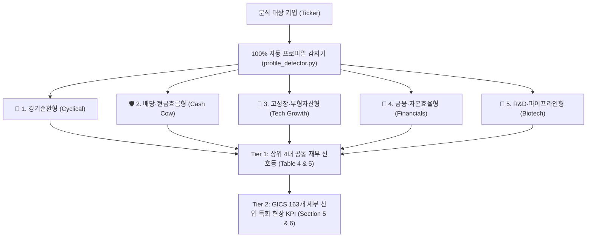

# 섹터 적응형 5대 비즈니스 프로파일 가치평가 체계

> **핵심 원칙**: 모든 상장 기업을 단일 잣대(저PER, 저PBR, 고성장률)로 평가하면 심각한 회계적 착시와 오판이 발생합니다. 기관 투자자는 기업이 **자본을 조달하고 현금을 창출하는 근본적인 메커니즘**에 따라 5대 메타 프로파일로 분류하여 맞춤 평가합니다.

---

## 1. 아키텍처 개요: 2-Tier 모듈형 평가 구조

---

## 2. 5대 비즈니스 프로파일 상세 명세

### 1) 🔄 경기순환형 (`cyclical`)
* **적용 섹터**: 반도체, 철강, 화학, 정유, 해운, 조선, 건설, 자동차, 하드웨어 부품
* **비즈니스 본질**: 대규모 설비투자(CapEx)와 고정비 구조로 인해 **공급 부족(호황) ↔ 공급 과잉(불황)**이 3~5년 주기로 반복됩니다. 이익 정점(Peak)에서 PER이 가장 낮아 보이고(저PER 함정), 이익 바닥(Trough)에서 적자 또는 고PER이 나타납니다.

| 평가 축 (Table 4) | 활성 지표 (Table 5) | 🟢 양호 (Good) | 🟡 보통 (Neutral) | 🔴 주의 (Caution) |
|---|---|:---:|:---:|:---:|
| **밸류에이션** | **P/B 밴드 위치 (`band`)** | 과거 중앙값 이하 | 중앙값 ~ 최고치 이하 | 과거 최고치 초과 |
| **수익성/사이클** | **사이클 위치 (`cycle`, OPM)** | 과거 중앙값 미만 (바닥 회복) | 중앙값 ~ 최고치 이하 | 과거 최고치 초과 (정점 위험) |
| **성장 모멘텀** | **30일 추정치 방향 (`rev`)** | 상향 비율 ≥ +30% | -30% ~ +30% | 하향 비율 ≤ -30% |
| **재무 건전성** | **부채비율 (`de`, D/E)** | < 50% | 50% ~ 100% | > 100% |
| **🚫 왜곡 제외 (`· 제외`)** | **Forward PE, PEG, 매출성장, EV/EBITDA, ROE** | *사이클 정점에서 모든 수익·성장 배수가 가장 좋아 보이는 착시를 유발하므로 판정에서 전면 제외* |

---

### 2) 🛡️ 배당·현금흐름형 (`cash_cow_dividend`)
* **적용 섹터**: 필수소비재(음료, 식품, 담배, 생활용품), 유틸리티(전력, 도시가스, 수도), 통신서비스(이통사), 인프라 맥쿼리/리츠
* **비즈니스 본질**: 성숙기 시장에서 강력한 브랜드 해자와 가격결정력(인플레이션 전가력)을 바탕으로 안정적인 잉여현금흐름(FCF)을 창출하고 주주에게 배당 및 자사주 소각으로 환원합니다.

| 평가 축 (Table 4) | 활성 지표 (Table 5) | 🟢 양호 (Good) | 🟡 보통 (Neutral) | 🔴 주의 (Caution) |
|---|---|:---:|:---:|:---:|
| **밸류에이션/현금화** | **FCF 전환율 (`fcf_conv`, FCF÷순이익)** | ≥ 80% | 50% ~ 80% | < 50% |
| **수익성/주주환원** | **FCF 배당성향 (`fcf_payout`, 배당÷FCF)** | < 80% (안전 배당) | 80% ~ 100% | > 100% (차입 배당 위험) |
| **성장 모멘텀** | **30일 추정치 방향 (`rev`)** | 상향 비율 ≥ +30% | -30% ~ +30% | 하향 비율 ≤ -30% |
| **재무 건전성** | **순부채/EBITDA (`net_debt_ebitda`)** | < 3.0배 | 3.0배 ~ 4.5배 | > 4.5배 |
| **🚫 왜곡 제외 (`· 제외`)** | **P/B (PBR), 고성장 잣대(매출성장 20%), 사이클 위치** | *수십 년간의 자사주 매입·소각으로 자본총계(Book Value)가 줄어들어 PBR이 10배 이상으로 왜곡되며, 연 3~6% 매출 성장만으로도 최상위 우량주임* |

---

### 3) 🚀 고성장·무형자산형 (`tech_high_growth`)
* **적용 섹터**: 소프트웨어(SaaS, 보안, ERP), 인터넷 플랫폼, 클라우드, 디지털 미디어, 이커머스
* **비즈니스 본질**: 공장 설비(유형자산) 대신 연구개발(R&D)과 알고리즘·네트워크 효과(무형자산)로 성장합니다. 높은 매출총이익률(GPM 70~80%)과 영업 레버리지를 통해 매출 성장과 잉여현금흐름을 동시에 달성하는지가 핵심입니다.

| 평가 축 (Table 4) | 활성 지표 (Table 5) | 🟢 양호 (Good) | 🟡 보통 (Neutral) | 🔴 주의 (Caution) |
|---|---|:---:|:---:|:---:|
| **밸류에이션** | **PEG 비율 (`peg`, PE÷EPS성장률)** | < 1.0배 | 1.0배 ~ 2.0배 | > 2.0배 |
| **수익성/효율성** | **Rule of 40 (`rule_of_40`, 매출성장률+FCF마진)** | ≥ 40% | 25% ~ 40% | < 25% |
| **외형 성장성** | **매출 성장률 (`rg`, YoY)** | > 20% | 5% ~ 20% | < 5% (성장 엔진 둔화) |
| **재무 건전성** | **부채비율 (`de`, D/E)** | < 50% | 50% ~ 100% | > 100% |
| **추가 활성 지표** | **30일 추정치 방향 (`rev`)** | 상향 비율 ≥ +30% | -30% ~ +30% | 하향 비율 ≤ -30% |
| **🚫 왜곡 제외 (`· 제외`)** | **P/B 밴드, 단순 Forward PE, 사이클 위치** | *무형자산(SW·특허·인재)이 재무상태표 자본에 잡히지 않아 PBR이 무의미하며, 고성장기에는 단순 PER보다 성장성 대비 배수(PEG)와 Rule of 40가 표준임* |

---

### 4) 🏦 금융·자본효율형 (`financials`)
* **적용 섹터**: 시중은행, 금융지주, 생명보험, 손해보험, 증권/투자은행(IB), 여신전문/카드, 자산운용
* **비즈니스 본질**: 자기자본(Equity)을 레버리지하여 대출·유가증권 운용·보험 인수를 수행합니다. 일반 제조업에서는 위험 신호인 고객 예금과 보험책임준비금이 회계상 '부채'로 계상됩니다.

| 평가 축 (Table 4) | 활성 지표 (Table 5) | 🟢 양호 (Good) | 🟡 보통 (Neutral) | 🔴 주의 (Caution) |
|---|---|:---:|:---:|:---:|
| **자산 밸류에이션** | **P/B 밴드 위치 (`band`)** | 과거 중앙값 이하 | 중앙값 ~ 최고치 이하 | 과거 최고치 초과 |
| **자본 수익성** | **자기자본이익률 (`roe`, ROE)** | > 20% (국내 금융은 >10% 우수) | 10% ~ 20% | < 10% |
| **성장 모멘텀** | **30일 추정치 방향 (`rev`)** | 상향 비율 ≥ +30% | -30% ~ +30% | 하향 비율 ≤ -30% |
| **주주환원/건전성** | **배당수익률 (`div_yield`)** | > 3.5% | 2.0% ~ 3.5% | < 2.0% |
| **🚫 왜곡 제외 (`· 제외`)** | **부채비율 (`de`), EV/EBITDA, PEG, 매출성장 (`rg`)** | *고객 예금이 부채이므로 부채비율 1,000% 이상이 정상이며, 이자수익 모델이므로 EBITDA 및 EV/EBITDA 자체가 성립하지 않음* |

---

### 5) 🧪 R&D·파이프라인형 (`biotech_pipeline`)
* **적용 섹터**: 신약개발 바이오텍, 임상 단계 제약사, 유전자 치료제, 초기 딥테크(양자컴퓨팅·핵융합 등)
* **비즈니스 본질**: 임상 1/2/3상 통과 및 상업화 승인까지 5~10년간 구조적 영업적자가 필연적입니다. 당장의 이익 배수가 아니라 **임상 성공 전까지 유상증자 없이 버틸 수 있는 현금 생존 기간(Runway)**과 기술수출(L/O) 역량이 핵심입니다.

| 평가 축 (Table 4) | 활성 지표 (Table 5) | 🟢 양호 (Good) | 🟡 보통 (Neutral) | 🔴 주의 (Caution) |
|---|---|:---:|:---:|:---:|
| **생존 가능성** | **Cash Runway (`cash_runway`, 보유현금÷연간소진액)** | > 2.5년 (또는 영업현금 흑자) | 1.5년 ~ 2.5년 | < 1.5년 (유상증자 임박) |
| **기술 집중도** | **R&D 집약도 (`rd_intensity`, R&D÷매출)** | > 30% | 15% ~ 30% | < 15% |
| **임상 모멘텀** | **30일 추정치 방향 (`rev`)** | 상향 비율 ≥ +30% | -30% ~ +30% | 하향 비율 ≤ -30% |
| **재무 안전성** | **순현금 상태 (`net_cash`, 현금 > 총차입금)** | 순현금 (`현금 > 부채`) | - | 순차입 (`부채 > 현금`) |
| **🚫 왜곡 제외 (`· 제외`)** | **Forward PE, PEG, EV/EBITDA, ROE, P/B 밴드** | *상업화 이전 적자 구간이므로 이익 기반 멀티플(PER, EV/EBITDA, ROE)은 음수이거나 산출 불가하여 전면 제외* |

---

### 6) 일반 범용 (`general`)
* **적용 섹터**: 위 5대 특수 프로파일에 해당하지 않는 일반 제조·유통·비즈니스 서비스 기업
* **활성 지표 (7개 기둥)**: `Forward PE`, `PEG`, `매출성장률`, `EV/EBITDA`, `ROE(정규화)`, `부채비율(D/E)`, `30일 추정치 방향`
* **제외 지표**: `P/B 밴드`, `사이클 위치` 및 기타 특수 프로파일 전용 지표

---

## 3. 종합 의사결정 판정 규칙 (`decision_verdict`)

Table 5의 마지막 컬럼인 **'종합 판단'**은 해당 기업의 프로파일에 속한 **활성 지표(Active Pillars)**의 신호만을 집계하여 위에서부터 순차 판정합니다:

1. **🔴 주의 신호 2개 이상**: `🔴 신중 접근 (주의 신호 2개 이상)`
2. **⚪ 유효 신호 4개 미만** (활성 기둥이 4개 미만인 경우 전체 유효 시 통과): `⚪ 판단 보류 (데이터 부족)`
3. **🟢 양호 신호 4개 이상 & 🔴 주의 신호 0개**: `🟢 강력 매수 후보`
4. **🟢 양호 신호 3개 이상 & 🔴 주의 신호 1개 이하**: `🟢 매수 고려`
5. **그 외 조합**: `🟡 중립/관망` (🔴 1개 포함 시 `(주의 신호 1개)` 부기)

---

## 4. 관련 문서 링크
- [GICS 163개 세부 산업 지표 매트릭스](gics-163개-세부산업-지표-매트릭스.md)
- [위키 전체 인덱스](../index.md)
