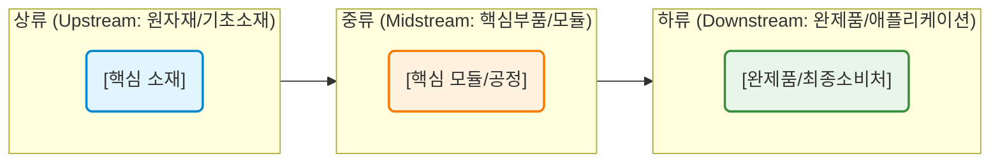

# [산업/기술명] 밸류체인(Value Chain) 분석 보고서

## 1. 산업 개요 및 분석 범위
* **산업 정의:** [분석 대상 산업 또는 기술에 대한 명확한 정의] [1]
* **핵심 제품/서비스:** [최종적으로 산출되는 제품 또는 서비스]
* **분석 목적 및 범위:** [본 분석이 다루는 범위와 초점]

## 2. 밸류체인 구조도 (Overview)

| 단계 | 주요 공정/부품 | 핵심 역할 및 부가가치 기여도 |
|---|---|---|
| **Upstream (상류)** | [예: 원자재, 기초 소재] [1] | [설명] |
| **Midstream (중류)** | [예: 핵심 부품, 장비, 모듈] [2] | [설명] |
| **Downstream (하류)** | [예: 완성품 조립, 최종 애플리케이션] [3] | [설명] |

## 3. 단계별 상세 분석 및 주요 기업 (Key Players)

### 3.1. Upstream (원자재 및 기초 소재)
* **주요 구성 요소:** [상세 설명] [1]
* **기술적 중요도 및 진입 장벽:** [상세 설명] [2]
* **경제적 해자(Moat) 및 병목도:** [자원 희소성, 특허, 정제 기술 등]
* **주요 기업 (Global / Domestic):**
    * [기업명 A]: [점유율, 핵심 경쟁력 및 시장 지위] [1]
    * [기업명 B]: [점유율, 핵심 경쟁력 및 시장 지위] [2]

### 3.2. Midstream (핵심 부품 및 모듈)
* **주요 구성 요소:** [상세 설명] [3]
* **기술적 중요도 및 진입 장벽:** [상세 설명] [4]
* **핵심 병목(Choke Point) 분석:** [기술 난이도가 가장 높거나 독점 공급 중인 부품] [5]
* **주요 기업 (Global / Domestic):**
    * [기업명 C]: [점유율, 경제적 해자 및 단가 협상력] [3]
    * [기업명 D]: [점유율, 경제적 해자 및 단가 협상력] [4]

### 3.3. Downstream (완성품 및 애플리케이션)
* **주요 구성 요소:** [상세 설명] [6]
* **시장 트렌드 및 수요 동인:** [상세 설명] [7]
* **주요 기업 (Global / Domestic):**
    * [기업명 E]: [점유율, 브랜드 파워 및 유통망] [6]
    * [기업명 F]: [점유율, 브랜드 파워 및 유통망] [7]

## 4. 핵심 병목 기업 및 투자 인사이트
* **밸류체인 최고 부가가치(병목) 구간:** [공급 부족 또는 기술 독점으로 가장 높은 마진을 누리는 단계] [1]
* **구조적 수혜 기업 (Top Pick):** [해당 병목을 장악하여 가격 결정권을 쥔 핵심 기업]
* **산업 구조 변화 촉매 및 주요 리스크:** [기술 전환, 대체재 등장, 지정학적 리스크 등] [3]
* **최종 요약:** [전체 가치사슬 분석의 핵심 결론 1~2문장]

---
*본 보고서는 공개된 정보 및 시장 데이터를 바탕으로 작성되었으며, 투자 판단의 참고 자료로만 활용하시기 바랍니다.*

## References
[1] [출처 제목 A](URL 주소 A) - 출처에 대한 간략한 설명
[2] [출처 제목 B](URL 주소 B) - 출처에 대한 간략한 설명
[3] [출처 제목 C](URL 주소 C) - 출처에 대한 간략한 설명
