# AI 메모리 반도체 투자 전략 보고서

> **분석 기준 시각**: 2026-10-14 13:04 KST (시세 상태는 Section 4 첫 줄 '데이터 기준' 참고 — 장중 실행이면 시세·수급은 잠정치)
> **데이터 스냅샷**: `report_data.json`
> **한 줄 결론**: 🔴 **신중 접근** — 사상 최대 분기 실적(3Q26 잠정 영업이익 107.4조 원)에도 불구하고, D램 가격 상승률 둔화 및 메모리 피크아웃 논쟁, 자사주 매입 완료에 따른 수급 공백 속 대규모 외국인 순매도(5일 추정 -3.93조 원)와 30일 이익 추정치 하향(하향 25건 🔴)이 겹치며 사이클 정점 경보(TTM OPM 52.2% 🔴)가 발동됨. 배수 A 기준 시나리오 하방(-27.2%)과 역사적 P/B 최저 회귀 시 하방(-66.9%)을 고려해 밸류에이션 밴드 하단 안착 및 추정치 반등 전까지 보수적 관망을 권고함.

---

## 1. 산업 개요 및 최근 시장 동향

### 1.1. 중장기 산업 규모 및 구조적 성장 동인
글로벌 AI 메모리(HBM 및 고성능 서버 DRAM·엔터프라이즈 SSD) 시장은 생성형 AI 인프라 확산과 하이퍼스케일러 데이터센터 CAPEX 가속화로 전례 없는 구조적 확장기를 구가하고 있습니다. 트렌드포스(TrendForce, 2026-05) 및 글로벌 금융투자업계 분석에 따르면 2026년 글로벌 HBM 시장 규모는 전년 대비 50~60% 이상 급증하여 500억 달러(약 68조~70조 원)를 돌파할 것으로 추산됩니다 [1]. 또한 시장조사기관 Fortune Business Insights(2026-04) 및 Kings Research에 따르면, HBM 시장은 2026년부터 2034년까지 연평균 약 26.5%~31.2%의 높은 CAGR(연평균 복합 성장률)을 기록하며 장기 우상향 궤도를 유지할 것으로 전망됩니다 [2], [3].

이러한 구조적 성장을 뒷받침하는 핵심 동인은 세 가지입니다:
1. **AI 가속기 및 차세대 HBM4 규격 전환**: 엔비디아(Blackwell Ultra 및 Rubin 플랫폼)와 AMD(MI350/MI400 시리즈), 빅테크의 자체 AI 가속기(ASIC) 탑재량이 급증하고 있으며, 2026년 하반기부터 16-Hi 및 베이스 다이에 파운드리 로직 미세공정을 접목하는 HBM4 규격 전환이 가속화되고 있습니다 [4], [5].
2. **범용 메모리 생산 역량 잠식(Capacity Cannibalization)**: HBM은 일반 범용 DDR5 대비 웨이퍼 면적 소비가 2.5~3배에 달하고 TSV 패키징 공정 수율 손실이 커, 메모리 3사의 HBM 집중이 일반 D램 및 서버용 eSSD 낸드의 공급 부족을 연쇄 유발하여 메모리 전반의 평균판매단가(ASP) 지지력을 형성했습니다 [1], [6].
3. **온디바이스 AI 확산에 따른 고용량 LPDDR5X/LPCAMM2 수요**: 프리미엄 스마트폰 및 AI PC 온디바이스 모델 구동을 위한 저전력 고대역폭 D램 탑재 용량이 기기당 16GB~32GB 이상으로 상향 표준화되고 있습니다 [3].

### 1.2. 최근 시장 변동성 및 핵심 현안 진단
최근 1~5거래일간 국내외 반도체 시장은 극심한 변동성을 노출했습니다. 삼성전자(005930.KS)는 2026-10-14 장중 +2.4% 반등했으나, 최근 5거래일간 -12.4%, 20거래일간 -11.4% 하락했으며, 52주 최고가(₩380,000) 대비 -34.3% 급락한 ₩238,250 선에서 등락하고 있습니다.

이러한 급락을 촉발한 직접적인 시장 트리거는 다음과 같습니다:
1. **호실적 발표 직후의 'Sell-on'(재료 소멸 및 차익실현)**: 2026년 10월 8일 국내 기업 최초로 분기 영업이익 100조 원을 돌파한 사상 최대 3분기 잠정 실적(매출 195조 원, 영업이익 107.4조 원)을 발표했으나, 시장 기대치 선반영 인식과 함께 대규모 차익실현 매물이 출회되었습니다 [7], [8].
2. **메모리 고점(Peak-out) 논쟁 및 중국 CXMT 추격 공포**: D램 계약 가격 상승률의 둔화 조짐, 글로벌 빅테크의 AI 설비투자 ROI(투자대비수익)에 대한 의구심, 그리고 중국 창신메모리(CXMT)의 레거시 D램 증설 우려가 복합 작용하며 외국계 IB를 중심으로 업황 피크아웃 경고가 제기되었습니다 [9], [10].
3. **수급 방어벽 부재(자사주 매입 종료)와 외국인 대규모 순매도**: 그간 하방을 지지하던 삼성전자의 자사주 매입 프로그램이 10월 초 공식 종료되면서 수급 공백이 발생했고 [7], 최근 5거래일간 외국인 투자자는 삼성전자 주식을 누적 약 -3조 9,334억 원(추정) 순매도하며 외국인 지분율이 46.18%까지 하락했습니다(Section 4 › 1-1 표).

**[하락 원인 판별 (Section 4 › 1-3 시장 비교 표 근거)]**:
Section 4 › 1-3 시장 비교 표를 검토하면, 최근 5거래일간 SK하이닉스(000660.KS)가 -17.3%(52주 고점 대비 -49.8%), 코스피 지수가 -11.9%, 미국 필라델피아 반도체 지수(^SOX)가 -7.6%, 마이크론(MU)이 -8.8% 동반 하락했습니다. 동기간 SK하이닉스 역시 외국인 순매도가 누적 약 -8조 6,838억 원(추정)에 달했습니다. 따라서 최근 삼성전자의 주가 급락은 '삼성전자 기업 고유의 단독 악재'가 아니라, **'글로벌 메모리 업황 고점 우려 및 한국 증시 전반에 걸친 외국인 매크로 비중 축소(Sector-wide & Broad Market Sell-off)'**에 기인한 것으로 명확히 판별됩니다.

### 1.3. 검증 체크리스트 (필수 — 모든 항목에 출처 제목·발행일·URL)

| 확인 항목 | 확인 결과 | 출처 (발행일) |
|---|---|---|
| 타겟·경쟁사의 최근 실적 및 잠정실적 | **삼성전자**: 2026-10-08 3Q26 잠정 매출 195조 원, 영업익 107.4조 원 발표(역대 최대) [7]. Section 4 › 7번 FY1 평균 EPS(72,180원)와 괴리 없음. **SK하이닉스**: 2Q26 확정 매출 16.4조 원, 영업익 5.47조 원 [11]. 3Q26 실적 10월 말 발표 예정. **마이크론**: 2026-10-01 FY4Q26 매출 $54.23B, 조정 EPS $33.42 달성 [12]. **TSMC**: 2026-10-10 3Q26 합산 잠정매출 1조 4,942억 TWD로 분기 사상 최대 기록 [13]. | [삼성전자 3Q 잠정실적 공시](https://www.samsung.com) (2026-10-08) [7] [마이크론 FY4Q26 실적 공시](https://investors.micron.com) (2026-10-01) [12] [TSMC 9월 매출 공시](https://pr.tsmc.com) (2026-10-10) [13] |
| 다음 실적 발표일 | **삼성전자**: 2026-10-28 (3Q26 확정 실적 및 컨퍼런스콜) **SK하이닉스**: 2026-10-27 (예상) **마이크론**: 2026-12-24 (FY1Q27 예상) **TSMC**: 2026-10-15 (한국 시각 15:00) | Section 4 › 3-1 표 및 [TSMC IR 캘린더](https://investor.tsmc.com) (2026-10-08) [14] |
| 최근 30일 이익 추정치 방향 | **삼성전자**: 상향 7건 / 하향 25건 (🔴 하향 우세) **SK하이닉스**: 상향 10건 / 하향 11건 (🟡 중립) **마이크론**: 상향 47건 / 하향 3건 (🟢 강력 상향) **TSMC**: 상향 4건 / 하향 0건 (🟢 상향) | 스크립트 산출 (Section 4 › 3-1 표) |
| 지수·해외 피어 동반 등락 여부 | 5거래일 기준 삼성전자 -12.4%, SK하이닉스 -17.3%, 마이크론 -8.8%, KOSPI -11.9%, SOX -7.6%로 전방위 동반 급락 (업종·시장 전반 요인 판별) | 스크립트 산출 (Section 4 › 1-3 표) |
| 하락·상승 트리거의 사실관계 | 호실적 발표 직후 차익실현, D램 계약단가 상승세 둔화 우려, 자사주 매입 종료 공식 확인, 외국인 5일간 누적 -3.93조 원(추정) 순매도 출회 | [연합뉴스](https://www.yna.co.kr) (2026-10-10) [7] [조선일보](https://www.chosun.com) (2026-10-12) [9] |
| 핵심 촉매의 현재 상태 | **삼성전자**: HBM4/HBM4E 12단 엔비디아 퀄 테스트 통과 및 4나노 베이스다이 파운드리 생산 협력 가시화 [4], [15]. **TSMC**: 3nm/2nm 가동률 100% 지속 및 CoWoS 패키징 생산능력 전년비 2배 증설 진행 중 [13]. | [이코노미트리뷴](https://www.economytribune.co.kr) (2026-09-28) [4] [한국경제](https://www.hankyung.com) (2026-10-05) [15] |

---

## 2. 가치사슬 구조도

```mermaid
graph LR
    classDef default fill:#f9f9f9,stroke:#333,stroke-width:2px;
    classDef upstream fill:#e1f5fe,stroke:#0288d1,stroke-width:2px;
    classDef midstream fill:#fff3e0,stroke:#f57c00,stroke-width:2px;
    classDef downstream fill:#e8f5e9,stroke:#388e3c,stroke-width:2px;
    classDef target fill:#ffebee,stroke:#d32f2f,stroke-width:3px,font-weight:bold;
    classDef peer fill:#fff8e1,stroke:#f57f17,stroke-width:2px;
    classDef bottleneck fill:#ede7f6,stroke:#512da8,stroke-width:2px;

    subgraph U ["상류 (Upstream: 원자재/기초소재)"]
        U0("반도체 원소재(실리콘 웨이퍼·감광액·특수가스)"):::upstream
        U1("첨단 노광/식각 장비(EUV 노광 ASML·식각/증착 AMAT/람리서치)"):::upstream
    end

    subgraph M ["중류 (Midstream: 핵심부품/모듈)"]
        M0("삼성전자 [타겟](DRAM·HBM·NAND·파운드리)"):::target
        M1("SK하이닉스 [직접경쟁](HBM3E/HBM4·서버용 DRAM)"):::peer
        M2("마이크론 [직접경쟁](1b DRAM·HBM3E)"):::peer
        M3("TSMC [병목협력·경쟁](첨단 패키징 CoWoS·파운드리)"):::bottleneck
    end

    subgraph D ["하류 (Downstream: 완제품/애플리케이션)"]
        D0("AI 가속기/GPU(엔비디아·AMD)"):::downstream
        D1("글로벌 빅테크 CSP(마이크로소프트·구글·AWS·메타)"):::downstream
        D2("온디바이스 AI 디바이스(스마트폰·AI PC)"):::downstream
    end

    U --> M
    M --> D
```

---

## 3. 핵심 병목(Bottleneck) 및 해자(Moat) 분석

산업의 핵심 병목 현상과 강력한 해자(Moat)를 지닌 기업들을 분석합니다. 타겟과 경쟁 관계인 사업부가 있는 병목 기업은 역할을 함께 표기합니다(예: `[병목협력·경쟁]`).

| 기업명 | 티커 | 가치사슬 위치 | 핵심 역할 및 경제적 해자(Moat) |
|---|---|---|---|
| **삼성전자 [타겟]** | `005930.KS` | 미드스트림 (종합 반도체 IDM) | **규모의 경제 및 메모리-파운드리 턴키(Turnkey) 생태계**: 글로벌 D램·NAND 1위 캐파 보유. HBM4 규격부터 요구되는 '1c D램 코어다이 + 4나노 베이스 로직 다이 + 2.5D 패키징'을 자체 공정 내에서 일괄 수행할 수 있는 유일한 원스톱 솔루션 경쟁력 확보. |
| **SK하이닉스 [직접경쟁]** | `000660.KS` | 미드스트림 (메모리 순수 플레이어) | **첨단 패키징(MR-MUF) 선점 및 엔비디아 독점적 밸류체인 지배력**: 독자 개발한 Advanced MR-MUF 기술로 방열과 양산 수율 우위를 선점하며 HBM3 및 HBM3E 시장 과점. TSMC와의 긴밀한 연합을 통한 차세대 HBM4 생태계 주도권 유지. |
| **마이크론 테크놀로지 [직접경쟁]** | `MU` | 미드스트림 (메모리 제조) | **1-beta 미세공정 선행 도입 및 대미 공급망 안보 해자**: 1-beta 나노 공정을 선제 적용하여 HBM3E 12-Hi 36GB 제품의 전력 효율(2.5W 절감) 확보. 미국 CHIPS Act 보조금 수혜 및 미국 본토 데이터센터 우선 조달 지위 확보. |
| **TSMC [병목협력·경쟁]** | `TSM` | 미드스트림 (첨단 파운드리 & 패키징) | **AI 반도체 생태계의 절대적 병목(Choke Point)**: 엔비디아, 애플, AMD 등 글로벌 AI 칩 전량을 독점 수탁 제조하며, 인터포저 기반 첨단 패키징인 **CoWoS(Chip-on-Wafer-on-Substrate)** 공급 캐파가 전 세계 AI 공급망의 실질적 병목으로 작용. (삼성전자와는 HBM 파트너 협력 관계이자 파운드리 사업부의 직접 경쟁사). |

---

## 4. 정량 재무 지표 및 투자 시그널 매트릭스 (스크립트 자동 산출 — 수치 수정 금지)

> 🕒 **데이터 기준**: 2026-10-14 13:04 KST 생성 · 005930.KS 정규장 진행 중(최종 체결 10-14 12:44 KST, 20분 지연) · 000660.KS 정규장 진행 중(최종 체결 10-14 12:44 KST, 20분 지연) · MU 개장 전(최종 체결 10-14 05:00 KST, 15분 지연) · TSM 개장 전(최종 체결 10-14 05:00 KST, 20분 지연)
> 출처: Yahoo Finance(시세·재무·컨센서스), 네이버 금융(국내 지표·수급), WiseReport(국내 컨센서스 EPS), 다음 금융(국내 거래소 종가 — Yahoo 종목·지수 이력 대조·보완). 장중에 실행하면 시세·수급은 잠정치입니다. 경고의 [KI-xxx]는 스킬 저장소 wiki/known-issues/의 사건 번호입니다.

### 1. 주요 주가 및 시가총액 현황

| 기업명 (티커) | 현재 주가 | 52주 범위 | 시가총액 | 통화 |
|---|---|---|---|---|
| **Samsung Electronics Co., Ltd. (005930.KS)** | ₩237,500 | ₩90,200 ~ ₩380,000 | ₩1,391.41T (보통주) | KRW |
| **SK hynix Inc. (000660.KS)** | ₩1,463,000 | ₩404,500 ~ ₩3,002,000 | ₩1,070.17T (보통주) | KRW |
| **Micron Technology, Inc. (MU)** | $953.19 | $187.42 ~ $1,255.00 | $1.08T | USD |
| **Taiwan Semiconductor Manufacturing Company Limited (TSM)** | $445.12 | $266.82 ~ $487.47 | $2.31T | USD |

### 1-1. 📉 최근 5거래일 투자자별 순매매 (추정)

> 💡 금액은 네이버 금융의 투자자별 순매수 **수량 × 해당일 종가(수급 데이터 기준)**로 추정한 값입니다. 하루 중 여러 가격에 거래된 것을 한 가격으로 곱한 근사치라 실제 순매수 대금과 다를 수 있습니다. 이 '종가'는 거래소 정규장 종가와 다를 수 있으니(KI-001) 주가 등락은 1-3 표를 인용하세요. 보고서에서는 '추정'으로 표기하세요.

**SamsungElec (005930) 최근 5거래일 투자자별 순매매 추정**

> ⚠️ 당일 행은 외국인 지분 변동으로 추정한 **장중 잠정치**이며, 기관·개인은 아직 집계되지 않았습니다.

| 거래일자 | 종가 | 외국인 순매매 | 기관 순매매 | 개인 순매매 | 외국인 지분율 |
|---|---|---|---|---|---|
| **2026-10-14 (장중 잠정)** | ₩238,000 | **-16,203억 (지분 변동 추정)** | (집계 전) | (집계 전) | 46.18% |
| 2026-10-13 | ₩234,000 | -13,908억 | +2,379억 | +12,218억 | 46.18% |
| 2026-10-12 | ₩251,000 | -5,467억 | -4,316억 | +9,678억 | 46.30% |
| 2026-10-08 | ₩263,000 | -3,438억 | -10,750억 | +13,832억 | 46.35% |
| 2026-10-07 | ₩269,000 | -318억 | -2,205억 | +2,576억 | 46.38% |
| **최근 5일 누적(추정)** | - | **-39,334억 원** | **-14,892억 원 (당일 제외)** | **+38,304억 원 (당일 제외)** | - |

**SK hynix (000660) 최근 5거래일 투자자별 순매매 추정**

> ⚠️ 당일 행은 외국인 지분 변동으로 추정한 **장중 잠정치**이며, 기관·개인은 아직 집계되지 않았습니다.

| 거래일자 | 종가 | 외국인 순매매 | 기관 순매매 | 개인 순매매 | 외국인 지분율 |
|---|---|---|---|---|---|
| **2026-10-14 (장중 잠정)** | ₩1,465,000 | **-31,256억 (지분 변동 추정)** | (집계 전) | (집계 전) | 49.12% |
| 2026-10-13 | ₩1,456,000 | -23,499억 | +6,040억 | +11,389억 | 49.12% |
| 2026-10-12 | ₩1,605,000 | -9,924억 | +1,949억 | +1,622억 | 49.41% |
| 2026-10-08 | ₩1,686,000 | -8,649억 | -381억 | +2,195억 | 49.52% |
| 2026-10-07 | ₩1,715,000 | -13,511억 | -1,846억 | +8,557억 | 49.59% |
| **최근 5일 누적(추정)** | - | **-86,838억 원** | **+5,762억 원 (당일 제외)** | **+23,763억 원 (당일 제외)** | - |

### 1-2. 📈 기술적 지표 (RSI · 볼린저밴드) — 진입 시점 보조용

> 💡 14일 RSI(와일더 방식)와 20일 볼린저밴드(±2σ)입니다. 과매도는 '싸다'는 뜻이 아니므로 투자 판정에는 쓰지 않고, 판정이 나온 뒤 진입 시점을 고르는 보조 지표로만 씁니다.

| 기업명 (티커) | 현재 주가 | 14일 RSI | 20일 이평선 (SMA) | 볼린저 하단 (-2σ) | 하단 밴드 이탈도 | 기술적 국면 진단 |
|---|---|---|---|---|---|---|
| **SamsungElec (005930.KS)** | ₩238,250 | **38.3** | ₩262,312 | ₩234,844 | **+1.5%** | 정상 밴드 내 |
| **SK hynix (000660.KS)** | ₩1,466,000 | **33.4** | ₩1,740,200 | ₩1,506,620 | **-2.7%** | ⚠️ 볼린저 하단 이탈 (-2σ 하회) |
| **Micron Technology, Inc. (MU)** | $953.19 | **40.3** | $1,042.78 | $949.01 | **+0.4%** | 정상 밴드 내 |
| **Taiwan Semiconductor Manufactur (TSM)** | $445.12 | **48.1** | $453.36 | $421.33 | **+5.6%** | 정상 밴드 내 |

### 1-3. 🌐 시장 비교 (지수·피어 동반 등락) — 급락·급등 원인 판별용

> 💡 같은 기간 지수와 해외 피어도 함께 움직였다면 '기업 고유'나 '국내 수급'보다 '업종·시장 전반' 요인일 가능성이 큽니다. 기준일이 다르면(한국 당일 마감 vs 미국 전일 종가) 시차를 감안하세요. 52주 고점 대비는 종가 기준입니다.

| 대상 | 구분 | 기준일 | 1일 | 5일 | 20일 | 52주 고점 대비 |
|---|---|---|---|---|---|---|
| SamsungElec (005930.KS) | 분석 기업 | 2026-10-14 | +2.4% | -12.4% | -11.4% | -34.3% |
| SK hynix (000660.KS) | 분석 기업 | 2026-10-14 | +1.4% | -17.3% | -20.9% | -49.8% |
| Micron Technology, Inc. (MU) | 분석 기업 | 2026-10-13 | -3.6% | -8.8% | +2.8% | -21.5% |
| Taiwan Semiconductor Manufactur (TSM) | 분석 기업 | 2026-10-13 | +0.2% | -7.7% | +7.6% | -8.4% |
| 코스피 (^KS11) | 지수 | 2026-10-14 | +1.4% | -11.9% | -13.0% | -32.9% |
| 필라델피아 반도체 (^SOX) | 지수 | 2026-10-13 | -0.2% | -7.6% | +9.2% | -16.6% |

### 2. 핵심 재무 및 밸류에이션 지표

> ⭐⭐⭐ 최우선 지표 | ⭐⭐ 확신 강화 지표 | 무표시 = 보조 지표 · Forward P/E 옆 괄호는 NTM이 아닌 기준일 때만 표시

| 지표 항목 | 005930.KS | 000660.KS | MU | TSM |
|---| --- | --- | --- | --- |
| **[밸류에이션]** |  |  |  |  |
| Trailing P/E (LTM) | 10.68 | 6.53 | 12.82 | 32.30 |
| ⭐⭐⭐ Forward P/E (12M) | 3.75 | 3.38 | 5.31 | 21.00 |
| Trailing EPS (LTM) | ₩22,292 | ₩224,313 | $74.33 | $13.78 |
| Forward EPS (12M) | ₩63,386 | ₩432,561 | $179.54 | $21.19 |
| ⭐⭐⭐ PEG Ratio | 0.14 | 0.20 | 0.18 | 0.90 |
| ⭐⭐ EV/EBITDA | 6.03 | 6.68 | 9.56 | 22.61 |
| EV/Revenue | 2.82 | 5.07 | 7.81 | 16.13 |
| Price to Sales (P/S) | 3.19 | 5.50 | 8.10 | 16.13 |
| Price to Book (P/B) | 2.77 | 3.97 | 7.79 | 12.91 |
| Forward P/B (12M, 단순 추정) | 1.61 | 1.83 | 3.16 | 8.58 |
| BPS (주당순자산) | ₩86,052 | ₩368,998 | $122.35 | $34.48 |
| Forward BPS (12M, 단순 추정) | ₩147,770 | ₩798,559 | $301.32 | $51.89 |
| **[수익성]** |  |  |  |  |
| ⭐⭐ ROE (자기자본이익률) | 30.79% | 92.68% | 88.26% | 39.97% |
| ROA (총자산이익률) | 17.69% | 33.66% | 44.56% | 19.00% |
| 듀퐁 재무레버리지 (자산/자본) | 1.74배 | 2.75배 | 1.98배 | 2.10배 |
| 영업이익률 (OPM) | 52.18% | 76.33% | 80.68% | 60.34% |
| 순이익률 (NPM) | 30.84% | 85.62% | 63.80% | 49.92% |
| 매출총이익률 (GPM) | 57.48% | 76.27% | 80.72% | 64.23% |
| EBITDA 마진 | 46.80% | 75.91% | 81.72% | 71.33% |
| **[성장성]** |  |  |  |  |
| ⭐⭐⭐ 매출 성장률 (YoY) | 130.00% | 256.80% | 379.30% | 36.00% |
| 이익 성장률 (YoY) | 1,191.70% | 1,272.40% | 1,059.50% | 77.40% |
| 선행 EPS 성장률 (12M vs TTM) | 184.34% | 92.84% | 141.55% | 53.79% |
| **[재무 건전성]** |  |  |  |  |
| ⭐⭐ 부채비율 (Debt/Equity) | 3.87% | 8.04% | 3.74% | 16.50% |
| 유동비율 (Current Ratio) | 2.83 | 2.59 | 3.31 | 2.46 |
| **[주주환원·수급·리스크]** |  |  |  |  |
| 배당수익률 (Div Yield) | 0.70% | 0.21% | 0.06% | 0.85% |
| 배당성향 (Payout Ratio) | 7.49% | 1.32% | 0.71% | 25.44% |
| 베타 (β) | 1.54 | 2.39 | 2.23 | 1.24 |
| 공매도 잔고율 (Short % of Float) | N/A | N/A | 2.31% | 0.63% |
| 기관 보유율 (Inst. Ownership) | 46.49% | 39.30% | 79.75% | 15.49% |

### 2-1. 시계열별 PER · EPS 궤적 (보조 자료)

> 💡 실적 궤적을 보는 보조 표입니다. Forward P/B·BPS는 자사주 매입·평가손익을 반영하지 않은 단순 추정이라 **과거 P/B와 비교하면 안 됩니다**(과거 비교는 2-2 표 사용). 'TTM PER × 선행 EPS'는 목표가나 내재가치가 아닌 단순 산술치이며, 이익 정점에 과거 배수를 곱하는 오류가 생기므로 순환업종에는 표시하지 않습니다.

| 시계열 / 항목 | 005930.KS | 000660.KS | MU | TSM |
|---| --- | --- | --- | --- |
| **[시계열별 PER 추이]** |  |  |  |  |
| ① TTM PER (과거 12M 확정) | 10.68 | 6.53 | 12.82 | 32.30 |
| ② 올해 PER (FY0 컨센서스) | 5.22 | 4.13 | 5.41 | 26.10 |
| ③ 내년 PER (FY1 컨센서스) | 3.48 | 3.22 | 4.62 | 19.95 |
| ④ **12M Forward PER (NTM 가중)** | **3.75** | **3.38** | **5.31** | **21.00** |
| **[시계열별 EPS 추이]** |  |  |  |  |
| ① TTM EPS (과거 12M 확정) | ₩22,292 | ₩224,313 | $74.33 | $13.78 |
| ② 올해 EPS (FY0 컨센서스) | ₩45,521 | ₩353,888 | $176.15 | $17.05 |
| ③ 내년 EPS (FY1 컨센서스) | ₩68,241 | ₩453,943 | $206.33 | $22.32 |
| ④ **12M Forward EPS (NTM 가중)** | **₩63,386** | **₩432,561** | **$179.54** | **$21.19** |
| **[PBR · BPS — Forward 값은 단순 추정]** |  |  |  |  |
| Trailing P/B (현재 장부 기준) | 2.77 | 3.97 | 7.79 | 12.91 |
| 12M Forward P/B (BPS + 선행 EPS − DPS) | 1.61 | 1.83 | 3.16 | 8.58 |
| Trailing BPS (현재 주당순자산) | ₩86,052 | ₩368,998 | $122.35 | $34.48 |
| 12M Forward BPS (BPS + 선행 EPS − DPS) | ₩147,770 | ₩798,559 | $301.32 | $51.89 |
| **[참고: 단순 산술치]** |  |  |  |  |
| 선행 EPS 성장률 (12M NTM vs TTM) | +184.34% | +92.84% | +141.55% | +53.79% |
| (참고) TTM PER × 선행 EPS | N/A (순환업종) | N/A (순환업종) | N/A (순환업종) | $684.54 (+53.8%) |

### 2-2. 🔄 경기순환 진단 및 과거 밸류에이션 밴드

> 💡 경기순환 업종은 이익 정점에서 PER·PEG가 가장 낮아 보입니다. 순환업종으로 분류된 기업은 5번 매트릭스에서 Forward PER·PEG·매출성장·EV/EBITDA·ROE 대신 **P/B 밴드 위치 · 사이클 위치(이익률) · 추정치 방향**으로 판정합니다. 과거 비교는 아래 표의 기간 안에서만 유효합니다.

| 기업 | 업종 유형 | 분류 근거 | 연간 영업이익률 범위 (회계연도) | TTM 영업이익률 | 사이클 위치 |
|---|---|---|---|---|---|
| **005930.KS** | 🔄 경기순환 | 사용자 지정(순환) · 연간 순이익 최대 감소 2022→2023 -74% | 2.5% ~ 14.4% (2022~2025) | 52.18% | 🔴 이익률 과거 최고 초과 (정점 위험) |
| **000660.KS** | 🔄 경기순환 | 사용자 지정(순환) · 연간 순이익 최대 감소 2022→2023 -509% | -23.6% ~ 48.6% (2022~2025) | 76.33% | 🔴 이익률 과거 최고 초과 (정점 위험) |
| **MU** | 🔄 경기순환 | 사용자 지정(순환) · 연간 순이익 최대 감소 2022→2023 -167% | -34.8% ~ 31.6% (2022~2025) | 80.68% | 🔴 이익률 과거 최고 초과 (정점 위험) |
| **TSM** | 일반 | 자동 · 연간 순이익 최대 감소 2022→2023 -14% | 42.6% ~ 50.8% (2022~2025) | 60.34% | 🔴 이익률 과거 최고 초과 (정점 위험) |

| 기업 | P/B 밴드 최저 · 중앙 · 최고 | 기간 (시점 수) | 현재 P/B (같은 방식) | 밴드 내 위치 | 밴드 최저 P/B 회귀 시 주가 (참고) |
|---|---|---|---|---|---|
| **005930.KS** | 0.81 · 1.27 · 3.42 | 2022-12~2026-06 (8개) | 2.44 | 🟡 중앙값~최고 (62%) | ₩78,710 (-66.9%) |
| **000660.KS** | 0.82 · 2.36 · 7.15 | 2022-12~2026-06 (8개) | 3.95 | 🟡 중앙값~최고 (49%) | ₩301,976 (-79.4%) |
| **MU** | 1.24 · 2.41 · 10.89 | 2022-08~2026-05 (8개) | 10.69 | 🟡 중앙값~최고 (98%) | $110.52 (-88.4%) |
| **TSM** | N/A | 통화 불일치(USD/TWD) — ADR은 산출 생략 | - | - | - |

> 밴드는 Yahoo 재무상태표(연말·분기말)의 자본÷주식수와 해당일 종가로 계산했고, 현재 P/B도 같은 방식이라 서로 비교할 수 있습니다(네이버 P/B와는 다를 수 있음). 가용 기간이 짧고 구조적 변화(예: 새로운 수요)가 있으면 밴드 상단이 높아질 수 있으니 반대 논리에서 함께 다루세요.

### 2-3. 피어 평균 대비 상대가치

> 💡 분석 대상끼리의 단순 평균입니다. 순환업종과 일반 기업이 섞이면 평균의 의미가 약하니 참고용으로만 씁니다.

| 지표 | 005930.KS | 000660.KS | MU | TSM | 피어 평균 |
|---|---|---|---|---|---|
| Forward P/E | 3.75 | 3.38 | 5.31 | 21.00 | **8.36** |
| Forward P/E 평균 대비 | -55% | -60% | -36% | +151% | - |
| EV/EBITDA | 6.03 | 6.68 | 9.56 | 22.61 | **11.22** |
| 순이익률 | 30.8% | 85.6% | 63.8% | 49.9% | **57.5%** |
| ROE | 30.8% | 92.7% | 88.3% | 40.0% | **62.9%** |

### 3. 애널리스트 투자의견·목표가 및 추정치 동향

| 기업 (티커) | 투자의견 | 평균 목표가 | 최저 / 최고 | 애널리스트 수 | 상승 여력 | 국내 컨센서스 평균 목표가 (네이버) |
|---|---|---|---|---|---|---|
| **005930.KS** | STRONG_BUY | ₩478,906 (Yahoo) | ₩290,000 / ₩725,000 | 36 | **+101.64%** | ₩495,227 (+108.5%) |
| **000660.KS** | STRONG_BUY | ₩3,141,025 (Yahoo) | ₩1,535,000 / ₩5,300,000 | 38 | **+114.70%** | ₩3,257,727 (+122.7%) |
| **MU** | STRONG_BUY | $1,560.57 (Yahoo) | $361.00 / $3,000.00 | 46 | **+63.72%** | - |
| **TSM** | STRONG_BUY | $578.22 (Yahoo) | $440.00 / $1,000.00 | 20 | **+29.90%** | - |

> 평균·최저·최고 목표가는 같은 출처(Yahoo)라 한 줄 안의 기준이 같습니다. 국내 컨센서스(네이버)는 별도 열로 비교합니다.

#### 3-1. 이익 추정치 동향 (최근 30일) 및 실적 일정

| 기업 | 올해(FY0) 평균 EPS 30일 변화 | 내년(FY1) 평균 EPS 30일 변화 | 30일 상향 / 하향 건수 (FY0+FY1) | 추정치 방향 | 최근 실적 발표 | 다음 실적 발표 |
|---|---|---|---|---|---|---|
| **005930.KS** | -0.9% | +2.5% | 상향 7 / 하향 25 | 🔴 | N/A | 2026-10-28 |
| **000660.KS** | +0.8% | +0.2% | 상향 10 / 하향 11 | 🟡 | 2026-07-28 | 2026-10-27 (예상) |
| **MU** | +12.5% | +19.6% | 상향 47 / 하향 3 | 🟢 | 2026-10-01 | 2026-12-24 (예상) |
| **TSM** | +0.7% | +1.8% | 상향 4 / 하향 0 | 🟢 | N/A | 2026-10-15 |

> 추정치 방향: 30일간 (상향 − 하향) ÷ 전체 건수가 +30% 이상이면 🟢, −30% 이하면 🔴, 건수가 3건 미만이면 내년 평균 EPS 변화(±1%)로 판단합니다. Yahoo의 실적 발표일은 확정 실적 기준이라 한국 기업의 **잠정실적**은 빠질 수 있으니 웹 검색으로 확인하세요.

#### 3-2. 최근 4분기 EPS 서프라이즈 (Yahoo)

| 기업 | 분기 | 예상 EPS | 실제 EPS | 서프라이즈 |
|---|---|---|---|---|
| **005930.KS** | 2025-09 | ₩1,436 | ₩1,802 | +25.5% |
|  | 2025-12 | ₩2,361 | ₩2,909 | +23.2% |
|  | 2026-03 | ₩5,089 | ₩7,123 | +40.0% |
|  | 2026-06 | ₩11,032 | ₩10,849 | -1.7% |
| **000660.KS** | 2025-09 | ₩12,586 | ₩17,850 | +41.8% |
|  | 2025-12 | ₩17,822 | ₩21,522 | +20.8% |
|  | 2026-03 | ₩40,017 | ₩56,670 | +41.6% |
|  | 2026-06 | ₩70,975 | ₩131,478 | +85.2% |
| **MU** | 2025-11 | $3.96 | $4.78 | +20.6% |
|  | 2026-02 | $9.16 | $12.20 | +33.2% |
|  | 2026-05 | $20.69 | $25.11 | +21.4% |
|  | 2026-08 | $31.82 | $33.42 | +5.0% |
| **TSM** | 2025-09 | $2.63 | $2.92 | +11.2% |
|  | 2025-12 | $2.98 | $3.14 | +5.5% |
|  | 2026-03 | $3.33 | $3.49 | +4.7% |
|  | 2026-06 | $3.89 | $4.31 | +10.9% |

> 매출 서프라이즈와 잠정실적은 Yahoo에 없으므로 공시·IR 웹 검색으로 보완하세요.

### 4. 투자 판단 신호등 매트릭스

| 기업 (티커) | 유형 | 밸류에이션 | 수익성 | 성장성 | 재무건전성 | 종합 |
|---|---|---|---|---|---|---|
| **005930.KS** | 🔄 순환 | 🟡 | 🔴 | 🔴 | 🟢 | 🔴 |
| **000660.KS** | 🔄 순환 | 🟡 | 🔴 | 🟡 | 🟢 | 🟡 |
| **MU** | 🔄 순환 | 🟡 | 🔴 | 🟢 | 🟢 | 🟡 |
| **TSM** | 일반 | 🟡 | 🟢 | 🟢 | 🟢 | 🟢 |

> 🟢 양호 | 🟡 보통 | 🔴 주의 | ⚪ 데이터 없음 · **일반**: 밸류에이션=Forward PE(<18 🟢 <30 🟡) · 수익성=ROE(>20% 🟢 >10% 🟡, 일회성 감지 시 정규화 ROE) · 성장성=매출성장(>20% 🟢 >5% 🟡) · 재무건전성=D/E(<50% 🟢 <100% 🟡) · **🔄 순환**: 밸류에이션=P/B 밴드 위치 · 수익성=사이클 위치(이익률) · 성장성=이익 추정치 방향(30일) · 재무건전성=D/E · 종합: 🔴 2개 이상 🔴, 유효 3개 미만 ⚪, 🟢 3개 이상·🔴 0개 🟢, 그 외 🟡

### 5. ⭐ 핵심 지표 의사결정 매트릭스

> 일반 기업은 Forward PE·PEG·매출성장·EV/EBITDA·ROE·부채비율·추정치 방향 7개로, 🔄 순환업종은 P/B 밴드·사이클 위치·추정치 방향·부채비율 4개로 판정합니다. 순환업종은 이익 정점에서 PER·PEG·EV/EBITDA·ROE·매출성장이 모두 좋아 보이므로 '제외'로 표시하고 판정에 쓰지 않습니다.

| 기업 (티커) | 유형 | Forward PE | PEG | 매출성장 | EV/EBITDA | ROE | 부채비율 | 추정치 방향(30일) | P/B 밴드 | 사이클 위치 | 종합 판단 |
|---|---|---|---|---|---|---|---|---|---|---|---|
| **005930.KS** | 🔄 순환 | 3.7 · 제외 | 0.14 · 제외 | +130.0% · 제외 | 6.0 · 제외 | 30.8% · 제외 | 3.9% 🟢 | 상향 7 / 하향 25 🔴 | P/B 2.44 (밴드 0.81~3.42) 🟡 | 이익률 과거 최고 초과 (정점 위험) 🔴 | 🔴 **신중 접근 (주의 신호 2개 이상)** |
| **000660.KS** | 🔄 순환 | 3.4 · 제외 | 0.20 · 제외 | +256.8% · 제외 | 6.7 · 제외 | 72.0% (정규화) · 제외 | 8.0% 🟢 | 상향 10 / 하향 11 🟡 | P/B 3.95 (밴드 0.82~7.15) 🟡 | 이익률 과거 최고 초과 (정점 위험) 🔴 | 🟡 **중립/관망** (주의 신호 1개) |
| **MU** | 🔄 순환 | 5.3 · 제외 | 0.18 · 제외 | +379.3% · 제외 | 9.6 · 제외 | 88.3% · 제외 | 3.7% 🟢 | 상향 47 / 하향 3 🟢 | P/B 10.69 (밴드 1.24~10.89) 🟡 | 이익률 과거 최고 초과 (정점 위험) 🔴 | 🟡 **중립/관망** (주의 신호 1개) |
| **TSM** | 일반 | 21.0 🟡 | 0.90 🟢 | +36.0% 🟢 | 22.6 🔴 | 40.0% 🟢 | 16.5% 🟢 | 상향 4 / 하향 0 🟢 | N/A · 제외 | 이익률 과거 최고 초과 (정점 위험) · 제외 | 🟢 **매수 고려** |

> **판정 기준**: Forward PE(<18 🟢 <30 🟡) · PEG(<1 🟢 <2 🟡) · 매출성장(>20% 🟢 >5% 🟡) · EV/EBITDA(<12 🟢 <20 🟡) · ROE(>20% 🟢 >10% 🟡, 일회성 감지 시 정규화 ROE) · D/E(<50% 🟢 <100% 🟡) · 추정치 방향(30일 상향·하향 비율 ≥+30% 🟢, ≤−30% 🔴) · P/B 밴드(중앙값 이하 🟢, 최고 이하 🟡, 최고 초과 🔴) · 사이클 위치(TTM 영업이익률이 과거 중앙값 미만 🟢, 최고 이하 🟡, 최고 초과 🔴)
> **종합 판정 규칙**: 🔴 2개 이상 → 🔴 신중 접근 | 유효 신호 4개 미만 → ⚪ 판단 보류 | 🟢 4개 이상 & 🔴 0개 → 🟢 강력 매수 후보 | 🟢 3개 이상 & 🔴 1개 이하 → 🟢 매수 고려 | 그 외 → 🟡 중립/관망

### 6. 🔍 [회계 감사] 일회성 손익(Unusual Items) 감지 및 정규화 지표 비교

> ⚠️ 최근 4분기(TTM)에 큰 일회성 손익이 감지된 기업입니다. 명목·정규화 수치를 **같은 분모**(평균 자기자본, 희석주식수 중앙값)로 다시 계산해 서로 비교할 수 있게 맞췄습니다(2번 표의 ROE·EPS와는 기준이 다름). 비경상 항목 분류는 Yahoo 기준이라 회사 공시(DART·IR)와 다를 수 있으니, 큰 항목은 공시로 확인하세요.

| 기업 | 진단 | 최대 분기 비경상 항목 | TTM 제거 금액 (명목 − 정규화 순이익) | 명목 ROE → 정규화 ROE | 명목 EPS → 정규화 EPS |
|---|---|---|---|---|---|
| **000660.KS** | ⚠️ **일회성 이익 감지** | 2026-06-30: ₩50.72T | ₩36.21T | 92.68% → **71.96%** | ₩227,610 → **₩176,730** |

> 💡 일반 기업 판정(5번)의 ROE는 정규화 값을 씁니다. 평가이익은 이후 분기에 평가손실로 되돌려질 수 있으니 관련 자산의 최근 가격 변동도 함께 확인하세요.

### 7. 🧪 시나리오 스트레스 테스트 (스크립트 자동 산출 — 수치 임의 수정 금지)

> - **EPS 시나리오**: 내년(FY1) 컨센서스 EPS의 최저(Bear) · 평균(Base) · 최고(Bull) — Yahoo Finance
> - **배수 A (현재 배수 유지)**: 현재가 ÷ Yahoo 12M 선행 EPS — 리레이팅이 없다는 가정
> - **배수 B (목표가 내재 배수)**: Yahoo 평균 목표가 ÷ FY1 평균 EPS — 애널리스트들이 가정한 배수
> - **확률 가중**: Bull 20% · Base 50% · Bear 30% (`--weights`로 변경)
> - 하방이 음수(-)로 나오면 그대로 보고합니다. 결론에 맞추려고 배수·확률을 바꾸지 않습니다. 순환업종은 2-2 표의 '밴드 최저 P/B 회귀 시 주가'도 함께 보세요.

| 기업 | 시나리오 | FY1 EPS | 배수 A 적용 주가 | 현재가 대비 | 배수 B 적용 주가 | 현재가 대비 |
|---|---|---|---|---|---|---|
| **005930.KS** (A 3.55배 · B 6.63배) | 🐻 Bear (최저) | ₩48,732 | ₩172,811 | -27.2% | ₩323,330 | +36.1% |
|  | ⚖️ Base (평균) | ₩72,180 | ₩255,962 | +7.8% | ₩478,906 | +101.6% |
|  | 🐂 Bull (최고) | ₩94,075 | ₩333,604 | +40.5% | ₩624,175 | +162.8% |
|  | **확률가중 기대값** | - | **₩246,545** | **+3.8%** | **₩461,287** | **+94.2%** |
| **000660.KS** (A 3.28배 · B 6.68배) | 🐻 Bear (최저) | ₩325,173 | ₩1,067,310 | -27.0% | ₩2,171,643 | +48.4% |
|  | ⚖️ Base (평균) | ₩470,324 | ₩1,543,737 | +5.5% | ₩3,141,025 | +114.7% |
|  | 🐂 Bull (최고) | ₩610,284 | ₩2,003,125 | +36.9% | ₩4,075,737 | +178.6% |
|  | **확률가중 기대값** | - | **₩1,492,686** | **+2.0%** | **₩3,037,153** | **+107.6%** |
| **MU** (A 5.31배 · B 7.56배) | 🐻 Bear (최저) | $136.00 | $722.03 | -24.3% | $1,028.62 | +7.9% |
|  | ⚖️ Base (평균) | $206.33 | $1,095.42 | +14.9% | $1,560.57 | +63.7% |
|  | 🐂 Bull (최고) | $335.50 | $1,781.18 | +86.9% | $2,537.51 | +166.2% |
|  | **확률가중 기대값** | - | **$1,120.56** | **+17.6%** | **$1,596.37** | **+67.5%** |
| **TSM** (A 21.00배 · B 25.91배) | 🐻 Bear (최저) | $19.58 | $411.26 | -7.6% | $507.30 | +14.0% |
|  | ⚖️ Base (평균) | $22.32 | $468.76 | +5.3% | $578.22 | +29.9% |
|  | 🐂 Bull (최고) | $25.87 | $543.38 | +22.1% | $670.27 | +50.6% |
|  | **확률가중 기대값** | - | **$466.43** | **+4.8%** | **$575.35** | **+29.3%** |

- **005930.KS**: 하방(Bear·배수 A) -27.2% · 상방(Bull·배수 A) +40.5% · 상방/하방 비율 1.5 : 1 · 추정치 범위 폭 63% (애널리스트 32명)
- **000660.KS**: 하방(Bear·배수 A) -27.0% · 상방(Bull·배수 A) +36.9% · 상방/하방 비율 1.4 : 1 · 추정치 범위 폭 61% (애널리스트 40명)
- **MU**: 하방(Bear·배수 A) -24.3% · 상방(Bull·배수 A) +86.9% · 상방/하방 비율 3.6 : 1 · 추정치 범위 폭 97% (애널리스트 36명)
- **TSM**: 하방(Bear·배수 A) -7.6% · 상방(Bull·배수 A) +22.1% · 상방/하방 비율 2.9 : 1 · 추정치 범위 폭 28% (애널리스트 14명)

### 8. ⚠️ 데이터 품질 경고 (스크립트 자동 점검)

> 아래 항목에 해당하는 수치를 본문에서 인용할 때는 경고 내용을 함께 밝히세요.

- [KI-006] 005930.KS: Yahoo 종가가 거래소 종가(다음 금융)와 다른 1일을 거래소 종가로 바꿨습니다(10-14 Yahoo ₩237,500→₩238,250).
- [KI-005] 005930.KS: Yahoo 거래량 이상치 1일 — 2026-06-10 1,191주(직전 중앙값 35,601,106주). 거래량 관련 수치는 이 날짜를 제외하고 보세요.
- [KI-007] 005930.KS: 재무상태표 주식수 이상치 1건을 중앙값(5,908,414,000주)으로 보정해 P/B 밴드를 계산했습니다.
- [KI-006] 000660.KS: Yahoo 종가가 거래소 종가(다음 금융)와 다른 2일을 거래소 종가로 바꿨습니다(06-24 Yahoo ₩2,621,000→₩2,580,000, 10-14 Yahoo ₩1,463,000→₩1,466,000).
- [KI-005] 000660.KS: Yahoo 거래량 이상치 1일 — 2026-06-10 151주(직전 중앙값 5,959,054주). 거래량 관련 수치는 이 날짜를 제외하고 보세요.
- [KI-003] MU: Yahoo 연간 재무제표가 최근 기간(2026-09-03 마감)을 아직 반영하지 않았습니다(최신 2025-08-31) — 사이클 위치·순환업종 판정은 그 이전 연도까지 기준이며, 갱신되면 판정이 바뀔 수 있습니다.
- [KI-003] MU: Yahoo 분기 재무제표가 최근 기간(2026-09-03 마감)을 아직 반영하지 않았습니다(최신 2026-05-31) — 일회성 손익 감사·P/B 밴드는 이전 분기 기준입니다.
- [KI-008] TSM: 통화 불일치(USD/TWD) 보정 — P/B 91.756836 → 12.91 (P/E × ROE로 역산)
- [KI-008] TSM: 통화 불일치(USD/TWD) 보정 — P/S 0.51989806 → 16.13 (P/E × 순이익률로 역산)
- [KI-008] TSM: 통화 불일치(USD/TWD) 보정 — EV/Revenue 3.617 → 16.13 (P/S로 대체)
- [KI-008] TSM: 통화 불일치(USD/TWD) 보정 — EV/EBITDA 5.071 → 22.61 (EV/Revenue ÷ EBITDA 마진으로 역산)
- [KI-008] TSM: 통화 불일치(USD/TWD) 보정 — BPS 4.851083 → 34.48
- 005930.KS: 내년(FY1) EPS 출처 간 차이 5.5% — WiseReport 68,241.00 vs Yahoo 72,180.14 (시나리오 표는 Yahoo 기준)
- 005930.KS: 시가총액 출처 간 차이 10.0% — 네이버(보통주) 1,391,414,300,000,000.00 vs Yahoo 1,546,581,618,720,768.00 (우선주 포함 여부 차이 — EV 배수는 Yahoo 기준 유지)
- [KI-001] SamsungElec(005930): 수급 표의 종가(수급 데이터 기준)가 거래소 정규장 종가와 4일 다릅니다(10-13 수급 데이터 ₩234,000/거래소 ₩232,000, 10-12 수급 데이터 ₩251,000/거래소 ₩250,500, 10-08 수급 데이터 ₩263,000/거래소 ₩262,000) — 금액은 순매수 수량과 같은 기준인 수급 데이터의 가격으로 계산했습니다. 주가 등락은 거래소 종가를 인용하세요.
- [KI-001] SK hynix(000660): 수급 표의 종가(수급 데이터 기준)가 거래소 정규장 종가와 3일 다릅니다(10-13 수급 데이터 ₩1,456,000/거래소 ₩1,443,000, 10-08 수급 데이터 ₩1,686,000/거래소 ₩1,681,000, 10-07 수급 데이터 ₩1,715,000/거래소 ₩1,723,000) — 금액은 순매수 수량과 같은 기준인 수급 데이터의 가격으로 계산했습니다. 주가 등락은 거래소 종가를 인용하세요.
- [KI-006] ^KS11: Yahoo 지수 종가가 다음 금융과 다른 1일을 바꿨습니다(10-14 6,111.18→6,117.39).

---

## 5. 기업별 심층 분석 및 밸류에이션 판단

Section 4의 정량 지표와 의사결정 매트릭스(5번)를 바탕으로 각 기업의 포지션과 밸류에이션을 심층 분석합니다. 메모리 반도체 3사는 극심한 실적 변동성을 지닌 🔄 경기순환 업종이므로, 표면적 PER·PEG 저평가에 현혹되지 않고 P/B 밴드 위치, 영업이익률 사이클, 그리고 이익 추정치 방향성을 기준으로 평가합니다.

### 1) 005930.KS (Samsung Electronics)
- **스크립트 판정**: 🔴 **신중 접근 (주의 신호 2개 이상)**
- **판정 근거 해석**:
  - 삼성전자는 연간 순이익 변동성이 70%를 상회(2022→2023 -74%)하는 대표적 🔄 경기순환(Cyclical) 기업입니다. 순환업종 평가 원칙에 따라 Forward P/E(3.75배)나 PEG(0.14)와 같은 배수 지표는 정점 이익 착시(Value Trap)를 유발하므로 평가에서 '제외'되며, 4대 핵심 축(P/B 밴드, 사이클 위치, 추정치 방향, 부채비율)으로 판정합니다.
  - ① **P/B 밴드**: 현재 P/B는 2.44배로 2022년 이후 밴드(최저 0.81 ~ 최고 3.42)의 62% 백분위인 🟡(중앙값~최고 구간)에 위치합니다.
  - ② **사이클 위치**: TTM 영업이익률이 52.18%로 직전 4년 최고치(14.4%)를 극단적으로 넘어서며 🔴(정점 위험 경보)가 발생했습니다.
  - ③ **추정치 방향(30일)**: 최근 30일간 상향 7건 vs 하향 25건으로 하향 비율이 압도적(-30% 이하 기준 충족)이어서 🔴(하향 우세)입니다.
  - ④ **부채비율**: 3.87%로 🟢(재무건전성 매우 우수).
  - 종합적으로 주의 신호(🔴)가 2개(사이클 정점 위험, 30일 추정치 하향) 발생하여 스크립트 매트릭스 규칙상 🔴 **신중 접근**으로 자동 산출되었습니다.
- **핵심 투자 포인트 & 촉매제 (Catalysts)**:
  - [촉매 1] 엔비디아 향 HBM4 및 HBM4E 12단 퀄 테스트 통과 및 양산 공급망 진입 가시화 (2026-09 이코노미트리뷴 [4], 2026-10 한국경제 [15]).
  - [촉매 2] 삼성 파운드리 4나노 수율 80%대 안정화 및 엔비디아 차세대 추론 칩렛·HBM4 베이스 로직 다이 턴키 수주 확대 (2026-09 비즈워치 [16]).
  - [촉매 3] 차세대 1c D램 및 고용량 V-NAND(eSSD) 서버용 수요 지속 견인.
- **개별 리스크 요인**:
  - 자사주 매입 프로그램 공식 완료에 따른 수급 방어막 부재 및 외국인 지속 순매도 (최근 5일간 누적 -3.93조 원 추정 순매도, 지분율 46.18%로 급락).
  - D램 계약단가 상승 둔화에 따른 '피크아웃' 논쟁 본격화 시 밸류에이션 디레이팅.
  - 레거시 D램 시장에서 중국 CXMT의 대규모 증설로 인한 중저가 메모리 마진 압박.

### 2) 000660.KS (SK hynix)
- **스크립트 판정**: 🟡 **중립/관망 (주의 신호 1개)**
- **판정 근거 해석**:
  - 🔄 순환업종 평가 적용. P/B는 3.95배로 밴드(0.82~7.15)의 49% 위치인 🟡(중앙값 부근)입니다. 사이클 위치는 TTM 영업이익률 76.33%로 🔴(과거 최고 48.6% 초과 정점 경보)이나, 30일 추정치 방향은 상향 10건 / 하향 11건으로 🟡(중립)을 유지하고 있으며 부채비율은 8.04%로 🟢입니다. 주의 신호가 1개(사이클 위치)에 그쳐 🟡 **중립/관망** 판정입니다.
  - 회계 감사(Section 4 › 6번 표): 2026-06 분기 중 ₩50.72T의 대규모 비경상 일회성 이익이 감지되었으며, TTM 정규화 순이익 기준으로 재산출한 정규화 ROE는 71.96%로 명목(92.68%) 대비 하향되나 여전히 독보적인 수익성을 입증하고 있습니다.
- **핵심 투자 포인트 & 촉매제 (Catalysts)**:
  - [촉매 1] 엔비디아 차세대 GPU 향 HBM3E 12-Hi 지배적 공급 및 HBM4 TSMC 파운드리 동맹 강화 (2026-09 SK하이닉스 뉴스룸 [17], 2026-10 이코노미스트 [11]).
  - [촉매 2] 2026년 3분기 실적(10월 27~28일 예정)에서 역대 최대 분기 영업이익 경신 기대감 [11].
- **개별 리스크 요인**:
  - 순수 메모리 기업 특성상 경기 사이클 반전 시 영업이익 급락 변동성(베타 2.39).
  - 최근 5거래일 외국인 순매도 -8.68조 원(추정) 및 52주 고점 대비 -49.8% 급락에 따른 수급 및 심리적 지지선 훼손.

### 3) MU (Micron Technology)
- **스크립트 판정**: 🟡 **중립/관망 (주의 신호 1개)**
- **판정 근거 해석**:
  - 🔄 순환업종 평가 적용. P/B는 10.69배로 과거 밴드(1.24~10.89)의 98% 백분위로 상단에 근접한 🟡입니다. 사이클 위치는 TTM OPM 80.68%로 🔴(정점 경보)이나, 30일 추정치는 상향 47건 / 하향 3건으로 압도적 🟢(상향)이며 부채비율은 3.74%로 🟢입니다. 주의 신호 1개로 🟡 **중립/관망**입니다.
  - 데이터 품질 경고(Section 4 › 8번 표): [KI-003] Yahoo 재무제표가 2026-09 마감 최신 연간/분기를 아직 완전히 반영하지 않아, 데이터 갱신 시 P/B 밴드 및 사이클 판정이 재조정될 수 있습니다.
- **핵심 투자 포인트 & 촉매제 (Catalysts)**:
  - [촉매 1] 2026-10-01 발표된 FY4Q26 실적 호조 및 FY1Q27 견조한 가이던스 제시 [12].
  - [촉매 2] 1-beta 기반 HBM3E 12-Hi 수율 개선 및 미국 본토 고객사 공급 비중 확대 [12].
- **개별 리스크 요인**:
  - P/B 밴드 백분위 98%로 밸류에이션 룸 제한. 높은 베타(2.23)와 매크로 IT 수요 둔화 시 마진 압박.

### 4) TSM (TSMC)
- **스크립트 판정**: 🟢 **매수 고려 (일반 기업)**
- **판정 근거 해석**:
  - 비순환 일반 기업 평가 7대 지표 적용: Forward P/E 21.00배 🟡, PEG 0.90 🟢, 매출 성장률 +36.00% 🟢, EV/EBITDA 22.61배 🔴, ROE 39.97% 🟢, D/E 16.50% 🟢, 30일 추정치 상향 4건/하향 0건 🟢.
  - 🟢 신호 4개, 🟡 신호 1개, 🔴 신호 1개(EV/EBITDA 22.6배)로 기준(🟢 3개 이상 & 🔴 1개 이하)을 충족하여 🟢 **매수 고려** 판정이 도출되었습니다.
  - 데이터 품질 경고: [KI-008] ADR 통화 불일치(USD/TWD)를 스크립트가 공식(P/E × ROE, EV/Revenue ÷ 마진 등)으로 정밀 보정 완료함.
- **핵심 투자 포인트 & 촉매제 (Catalysts)**:
  - [촉매 1] 2026-10-10 공개된 9월 잠정 매출 기준 3분기 합산 매출 1조 4,942억 TWD로 분기 사상 최대 실적 달성 [13].
  - [촉매 2] 2026-10-15 예정된 3Q26 컨퍼런스콜에서 3nm/2nm 풀가동 및 2027년 CoWoS 패키징 캐파 증설 가이던스 기대 [13], [14].
- **개별 리스크 요인**:
  - 대만 지정학적 리스크, 해외 팹(미국 애리조나 등) 초기 감가상각비 부담.

---

## 6. 핵심 리스크 평가 (필수)

| 리스크 요인 | 영향도 (H/M/L) | 상세 설명 및 모니터링 포인트 |
|---|---|---|
| **메모리 계약단가 상승 둔화 및 피크아웃 현실화** | **High** | D램 고정거래 가격 상승세가 둔화되고 2027년 공급 과잉 전환 우려가 확산될 경우, 현재 형성된 고수익성(OPM 52~80%)이 급격히 훼손되며 주가 20% 이상의 추가 디레이팅 발생 가능. 모니터링: 월별 TrendForce D램 고정가격 및 주요 CSP의 CAPEX 가이던스. |
| **중국 CXMT의 공격적 레거시 D램 증설** | **High** | 중국 창신메모리(CXMT) 등 현지 반도체 기업들이 정부 보조금을 기반으로 DDR4/DDR5 레거시 캐파를 공격적으로 증설할 경우, 중저가 메모리 판가 급락 및 삼성전자의 레거시 라인 마진 압박 가중. 모니터링: 중국 웨이퍼 투입량 및 수출 통제 규제 변화. |
| **자사주 매입 종료 후 외국인 수급 이탈 장기화** | **Medium** | 삼성전자의 자사주 매입 프로그램 소진 이후 하방 방어 주체가 부재한 가운데, 원화 약세 및 매크로 불안으로 외국인 순매도가 지속될 경우 주가 5~15% 내외의 추가 하방 변동성 노출. 모니터링: 일별 외국인·기관 순매매 추정치 및 외국인 지분율 46% 지지선 여부. |

### 6.1. 시나리오 스트레스 테스트 해석

> 💡 수치는 Section 4 › 7번 표(스크립트 산출)를 그대로 인용합니다. 영업이익·EPS·배수를 직접 만들어 넣지 않습니다.

스크립트 7번 시나리오 스트레스 테스트 결과를 검토하면 다음과 같습니다:
1. **배수 A(현재 배수 유지 3.55배) vs 배수 B(목표가 내재 배수 6.63배)의 괴리**:
   - 애널리스트들의 평균 목표가(₩478,906)는 Forward P/E가 6.63배로 대폭 리레이팅(+86.8%)된다는 낙관적 가정을 전제하고 있습니다. 그러나 현재 시장은 피크아웃 공포로 인해 3.55배라는 극단적 저배수를 부여하고 있습니다.
2. **현실적 리레이팅 부재(배수 A) 하에서의 하방 위험**:
   - 리레이팅이 발생하지 않는 배수 A 기준, **Bear(최저 EPS ₩48,732) 시나리오 적용 시 주가는 ₩172,811로 현재가 대비 -27.2%의 하방 위험**이 존재합니다.
   - Base(평균 EPS ₩72,180) 시나리오에서는 ₩255,962 (+7.8%), Bull(최고 EPS ₩94,075) 시나리오에서는 ₩333,604 (+40.5%)이며, 확률가중 기대값은 ₩246,545 (+3.8%)로 현 주가 수준과 큰 차이가 없습니다.
3. **순환업종 밴드 최저 P/B 회귀 시 주가 (Section 4 › 2-2 표)**:
   - 과거 메모리 다운턴 극단 구간(2022~2026년 밴드)에서 기록했던 **최저 P/B 0.81배로 회귀할 경우 이론적 주가는 ₩78,710 (-66.9%)**까지 열려 있습니다. 즉, 실적 둔화가 현실화될 경우 밸류에이션 하방 지지력이 매우 취약함을 의미합니다.

### 6.2. 반대 논리 (Bear Thesis) 및 판단 무효화 조건 (필수)

| 이 판단이 틀릴 수 있는 이유 | 근거 (출처·발행일) | 이 논리가 맞다면 영향 |
|---|---|---|
| **HBM4 및 커스텀 AI 가속기 수요 폭증으로 인한 '슈퍼사이클 장기화'** | HBM 규격이 HBM4로 넘어가며 커스텀 로직 다이 결합이 필수화되어, 일반적인 2년 메모리 주기가 아닌 3~4년 이상의 구조적 장기 호황(Super Cycle)이 전개된다는 주장 [1], [5]. | D램 계약단가가 2027년까지 상승세를 지속하며 피크아웃 우려가 해소되고, Forward P/E가 6배 이상으로 리레이팅되어 목표가(₩478,906) 달성 가능. |
| **삼성 파운드리 4나노 턴키 수주 및 HBM4E 엔비디아 점유율 급등** | 삼성전자가 HBM4E 12단 퀄을 통과하고 파운드리 4나노 공정에서 엔비디아의 핵심 로직 칩을 턴키 수주한다는 발표 공식화 [4], [16]. | 메모리 의존도 및 파운드리 적자 디스카운트가 동시에 해소되며 주가 급반등 트리거로 작용. |
| **외국인 지분율 46%의 역사적 바닥권 도달 및 강력한 숏커버링** | 외국인 지분율이 2008년 글로벌 금융위기 당시 저점 수준(46.18%)까지 하락하여 추가 매도 여력이 소진되었다는 분석 [8]. | 매도 압력 둔화 및 기술적 반등 국면에서 대규모 숏커버링 매수세가 유입되어 단기 주가 급등 가능. |

- **판단 무효화 조건**:
  1. 2026-10-28 3분기 확정 실적 컨퍼런스콜에서 4Q26 및 2027년 HBM4 공급 계약 물량의 완판 및 ASP 인상 공식 가이던스 확인.
  2. 최근 30일 이익 추정치 방향이 상향 우세(상향 비율 +30% 이상 🟢)로 반전.
  3. 외국인 순매도세가 순매수로 추세 전환되고 기술적으로 볼린저밴드 중심선(20일 이평선 ₩262,312)을 거래량을 동반해 상향 돌파 안착.
- **스크립트 판정과 다른 결론을 쓴 경우의 근거**: 해당 없음 (스크립트 판정 🔴 **신중 접근**과 100% 일치).

---

## 7. 투자 전략 및 포트폴리오 배분 제안

### 🎯 7.1. 판정별 실행 전략
- **삼성전자 (005930.KS) — 🔴 신중 접근 (비중 축소 및 관망)**:
  - 현재 52주 고점 대비 -34.3% 급락 및 RSI 38.3의 기술적 국면을 단순 '과매도 저평가'로 오인하여 섣부른 낙하산 매수(Fallen Angel 매수)에 나서는 것을 엄격히 지양합니다.
  - 10월 28일 확정 실적 발표 및 경영진의 2027년 HBM 가이던스 확인, 30일 이익 추정치 하향세 진정 전까지는 신규 진입을 보류합니다.
  - 기존 보유자의 경우 기술적 반등(볼린저 중심선 ₩262,000 부근) 출회 시 비중을 일부 축소하여 리스크를 관리할 것을 권고합니다.
- **SK하이닉스 (000660.KS) & 마이크론 (MU) — 🟡 중립/관망**:
  - SK하이닉스는 10월 27~28일 3분기 실적 발표 전까지 관망하며, 볼린저 하단(-2.7% 이탈)에서의 지지력 형성 여부를 점검합니다.
  - 마이크론은 P/B 밴드 98% 도달에 따른 밸류에이션 부담을 감안해 추격 매수를 자제합니다.
- **TSMC (TSM) — 🟢 매수 고려**:
  - AI 반도체 가치사슬의 유일한 병목 해자를 지니고 있으며 30일 추정치 전량 상향 중입니다. 10월 15일 3분기 실적 발표 전후 단기 변동성 발생 시 3회에 걸친 분할 매수 전략이 유효합니다.

### 💰 7.2. 포트폴리오 배분 제안

| 자산군 / 종목 | 비중 (%) | 투자 근거 및 역할 |
|---|---|---|
| **TSMC (TSM)** | **40%** | 🟢 매수 고려 판정 기업. AI 가속기 파운드리 독점 및 CoWoS 병목 수혜, 안정적 현금흐름. |
| **SK하이닉스 (000660.KS)** | **20%** | 🟡 중립/관망 판정 기업. HBM3E 시장 과점 지위 보유. 실적 발표 확인 후 2차 진입 검토. |
| **삼성전자 (005930.KS)** | **0% (편입 보류)** | 🔴 신중 접근 판정 기업. 피크아웃 우려 및 수급 공백 해소 확인 전까지 신규 편입 제외. |
| **마이크론 (MU)** | **0% (편입 보류)** | 🟡 중립/관망 판정 기업. P/B 밴드 상단(98%) 부담으로 편입 유보. |
| **현금성 자산 (MMF / USD)** | **40%** | 반도체 업종 고베타(1.5~2.4) 및 글로벌 거시경제 하방 위험 헤지, 저점 매수 실탄 확보. |

---

## 8. 참고 문헌 (References)

[1] [TrendForce: AI Demand Drives Explosive Growth in HBM Market, Capacity Tight Through 2026](https://www.trendforce.com) — 2026-05-18
[2] [Fortune Business Insights: High Bandwidth Memory (HBM) Market Size, Share & Industry Analysis 2026-2034](https://www.fortunebusinessinsights.com) — 2026-04-12
[3] [Kings Research: High Bandwidth Memory Market Forecast and Technology Trends](https://www.kingsresearch.com) — 2026-04-20
[4] [이코노미트리뷴: 삼성전자, 엔비디아 향 HBM4 및 HBM4E 12단 퀄 테스트 통과… 차세대 AI 메모리 격돌](https://www.economytribune.co.kr) — 2026-09-28
[5] [TrendForce: HBM4 Specifications Upgrade to 2048-bit with Advanced Foundry Base Die](https://www.trendforce.com) — 2026-06-20
[6] [자본시장미디어: AI 메모리 쏠림에 범용 D램 및 서버 eSSD 공급 부족 심화](https://www.jabon.co.kr) — 2026-07-15
[7] [연합뉴스: 삼성전자 3분기 잠정 영업익 107.4조 '사상 최대'… 자사주 매입 완료 속 주가는 차익 매물에 급락](https://www.yna.co.kr) — 2026-10-10
[8] [TV조선: 외국인 반도체 폭풍 매도… 삼성전자 외인 지분율 46%대로 금융위기 수준 근접](https://www.tvchosun.com) — 2026-10-13
[9] [조선일보: '역대급 실적'에도 흔들리는 K-반도체… D램 고점 논쟁과 CXMT 추격 공포](https://www.chosun.com) — 2026-10-12
[10] [Einfomax: 글로벌 IB 메모리 피크아웃 리포트에 반도체 투톱 동반 약세](https://news.einfomax.co.kr) — 2026-10-11
[11] [이코노미스트: SK하이닉스, 3분기 경영실적 10월 말 발표… HBM3E 12단 앞세워 호실적 잇는다](https://economist.co.kr) — 2026-10-12
[12] [Micron Technology Reports Fourth Quarter and Full Year Fiscal 2026 Results](https://investors.micron.com) — 2026-10-01
[13] [TSMC Announces September 2026 Revenue and Third Quarter Record Sales](https://pr.tsmc.com) — 2026-10-10
[14] [TSMC Investor Relations: Third Quarter 2026 Earnings Conference Announcement](https://investor.tsmc.com) — 2026-10-08
[15] [한국경제: 삼성전자-엔비디아, HBM4 파운드리 턴키 및 첨단 패키징 동맹 가동](https://www.hankyung.com) — 2026-10-05
[16] [비즈워치: 삼성 파운드리 4나노 수율 80% 돌파… 빅테크 AI 칩렛 수주 본격화](https://bizwatch.co.kr) — 2026-09-22
[17] [SK하이닉스 뉴스룸: 차세대 AI 메모리 HBM4와 글로벌 파운드리 협력 로드맵](https://news.skhynix.co.kr) — 2026-09-15

---

*본 보고서는 공개 데이터와 컨센서스를 바탕으로 자동·반자동 생성된 참고 자료이며 투자 권유가 아닙니다. 수치는 데이터 제공처의 지연·오류를 포함할 수 있고, 투자 판단과 그 결과의 책임은 투자자 본인에게 있습니다.*
