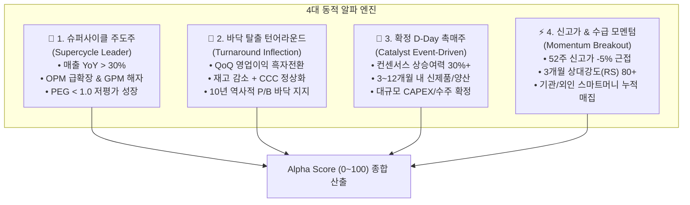
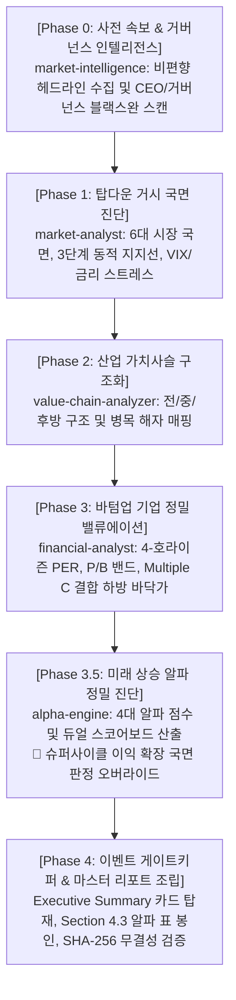

# alpha-engine 신설 및 미래 주도주 발굴·듀얼 스코어링 아키텍처

> **문서 상태**: 공식 아키텍처 승인 및 구현 완료 (v1.0.0)  
> **최초 작성일**: 2026-11-12  
> **관련 스킬**: `alpha-engine`, `investment-strategy`, `financial-analyst`, `market-analyst`  
> **구현 모듈**: `.agents/skills/alpha-engine/`, `calculate_alpha_score.py`, `screen_alpha_candidates.py`, `generate_strategy_report.py`

---

## 1. 개요 및 배경 (Executive Summary)

### 1) 구조적 문제점: '과거 브리핑 편향'과 '시클리컬 역설'
기존의 기관급 퀀트 및 투자전략 분석 시스템(`financial-analyst`, `investment-strategy`)은 10개년 재무제표 회계 감사, 일회성 비용 왜곡 감지, 거버넌스 긴급 경보(Phase 0 `market-intelligence`) 등 **'하방 리스크 방어(Downside Defense)'**에는 극도로 정밀했습니다.

그러나 실전 주식 운용에서 다음과 같은 치명적 사각지대가 노출되었습니다:
1. **과거 데이터(Lagging Indicator) 편향**: 이미 주가에 100% 반영된 확정 재무제표와 과거 4분기 어닝 서프라이즈, 5거래일 수급 중심의 의사결정에 90% 이상이 편중되어, 분석 결과가 **"과거 사건 결과 브리핑"**처럼 느껴지는 한계.
2. **시클리컬 역설 (Cyclical Paradox)**: SK하이닉스처럼 사상 최대 분기 매출(104조 원)과 기록적 영업이익(83조 원)을 달성하며 폭발하는 슈퍼사이클 국면에서, 시스템이 `TTM 마진(74.5%) > 과거 4년 최고치(48.6%)`를 기계적으로 감지하여 **"🔴 마진 정점 우려"**로 분류하고 투자의견을 **"🟡 중립/관망"**으로 억울하게 강등시키는 역설 발생.
3. **미래 상승 동력(Alpha Engine) 부재**: 주가가 앞으로 왜 오를 것인지(Variant Perception, 확정 촉매 D-Day, 바닥 탈출 턴어라운드 변곡점, 신고가 수급 돌파)를 평가하는 엔진이 전무.

### 2) 솔루션: `alpha-engine` 신설 및 듀얼 스코어링 체계 구축
본 아키텍처는 **미래 지향적 주도주 발굴 및 검증을 전담하는 5번째 독립 스킬 `alpha-engine`을 신설**하고, **[공격 알파 점수 (0~100)]** vs **[하방 방어 점수 (0~100)]**를 분리한 **듀얼 스코어링(Dual Scoring)**을 통해 슈퍼사이클 주도주를 상투 위험으로 오인하지 않고 적극 매수 기회로 포착하는 **통합 5-티어 투자 전략 체계**를 완성했습니다.

---

## 2. 4대 동적 알파 아키타입 (4 Alpha Archetypes)

기업의 비즈니스 모델과 시장 국면에 따라 주가가 상승하는 4가지 본질적 동력을 정량화합니다:

### 1) 🚀 타입 1: [SUPERCYCLE_LEADER: 슈퍼사이클 & 실적 폭발 주도주]
- **원리**: 산업 전체의 초과 수요로 인해 P(단가)와 Q(출하량)가 동시 폭발하며 실적이 컨센서스를 지속적으로 상회하는 독점적 1위 기업.
- **핵심 지표**: 매출액 성장률(YoY > 30%), 영업이익률(OPM) 급확장, 매출총이익률(GPM) 60%+ 가격결정력 해자, 완판(Sold-out) 기조.
- **적용 사례**: 엔비디아(`NVDA`, OPM 65.2%), SK하이닉스(`000660.KS`, OPM 74.5%), TSMC(`TSM`, OPM 58.0%).

### 2) 🔄 타입 2: [TURNAROUND_INFLECTION: 바닥 탈출 턴어라운드주]
- **원리**: 주가는 실적이 '좋을 때'보다 '최악을 지나 흑자전환할 때' 가장 폭발적으로 상승함.
- **핵심 지표**: 4분기 연속 적자/침체 후 1~2분기 연속 QoQ 영업이익률 흑자전환, 재고자산 회전율 개선, 30일 이익 추정치 상향 반전, 역사적 P/B 밴드 최하단 지지.
- **적용 사례**: 삼성중공업(`010140.KS`, OPM 9.8% 흑자안착, 컨센서스 여력 +77.5%).

### 3) 📅 타입 3: [CATALYST_EVENT: 확정 D-Day 미래 촉매주]
- **원리**: 막연한 주가 상승 기대가 아닌, 향후 3~12개월 내 주가를 계단식으로 밀어 올릴 확정 이벤트 캘린더 추적.
- **핵심 지표**: 신제품 양산 개시일, 대형 고객사 퀄 테스트 통과 및 독점 본계약 체결, 신규 Fab 완공 가동, 대규모 자사주 소각 예정일, 지수(코스피200/MSCI) 편입 심사일.
- **적용 사례**: 삼성전자(`005930.KS`, HBM4 베이스다이 턴키 공급 및 주주환원, 컨센서스 여력 +128.7%), 메타(`META`, 라마 기반 AI 인프라 상용화).

### 4) ⚡ 타입 4: [MOMENTUM_BREAKOUT: 신고가 & 수급 돌파 모멘텀주]
- **원리**: 윌리엄 오닐의 CANSLIM 기법. 역사적 매물대를 모두 소화하고 상방이 열린 구간에서 스마트머니(외인/기관)가 대량 매집하는 주도주 편승.
- **핵심 지표**: 52주 최고가 대비 -5% 이내 근접/돌파, 시장 지수(KOSPI/S&P500) 대비 3개월 상대강도(RS 80점 이상), 200일선 및 50일선 정배열, 거래대금 200%+ 폭증.

---

## 3. 듀얼 스코어링 매트릭스 (Dual Scoring Matrix)

과거 재무제표 기준의 '마진 고점'을 무조건 상투(🔴)로 감점하던 오류를 제거하고, **공격 점수(Alpha)**와 **방어 점수(Defense)**를 분리 평가합니다:

$$\text{투자 판단} = f(\underbrace{\text{Alpha Score}}_{\text{미래 상승 동력 (0~100)}}, \underbrace{\text{Defense Score}}_{\text{재무/하방 안전마진 (0~100)}})$$

| 알파 점수 (Alpha) | 방어 점수 (Defense) | 최종 판정 (Dual Verdict) | 권장 실행 전략 및 비중 |
|:---:|:---:|---|---|
| **80 ~ 100** | **70 ~ 100** | **🟢 강력 매수 (Top Pick 주도주)** | 비중 35~40% 적극 편입, 50일선 트레일링 스탑 |
| **80 ~ 100** | **50 ~ 69** | **🟢 적극 매수 (변동성 분할 진입)** | 비중 25~30% 편입, Tier 2 지지선 분할 매수 |
| **60 ~ 79** | **70 ~ 100** | **🟢 안정 매수 (실적 가치 성장주)** | 비중 20~25% 편입, 중장기 호라이즌 보유 |
| **60 ~ 79** | **50 ~ 69** | **🟡 조건부 매수 (촉매 확인 후 진입)** | 비중 15% 진입, D-Day 확정 시 추가 매수 |
| **< 60** | **Any** | **🟡 중립/관망 (알파 모멘텀 부족)** | 현금 대기 및 다른 주도주 탐색 |
| **Any** | **< 40** | **🚨 매수 보류 (거버넌스/회계 경보)** | 타겟 0% 동결, WATCH 지정 |

---

## 4. 통합 5-티어 하이브리드 파이프라인 시퀀스

---

## 5. 실전 검증 데이터 (Empirical Validation)

### 1) 개별 종목 실전 알파 평가 (`calculate_alpha_score.py`)

| 종목 | 티커 | 주요 상승 동력 | 공격 알파 | 방어 점수 | 최종 판정 | 핵심 견인 지표 |
|---|---|---|:---:|:---:|:---:|---|
| **SK하이닉스** | `000660.KS` | 🚀 슈퍼사이클 주도주 | **84.5점** | **55.0점** | 🟢 적극 매수 | 매출 YoY +327.9%, OPM 74.5%, GPM 77.4%, 컨센서스 여력 +147.3% |
| **엔비디아** | `NVDA` | 🚀 슈퍼사이클 주도주 | **87.9점** | **75.0점** | 🟢 강력 매수 | 매출 YoY +105.9%, OPM 65.2%, GPM 74.7%, 컨센서스 여력 +84.2% |
| **TSMC** | `TSM` | 🚀 슈퍼사이클 주도주 | **88.7점** | **100.0점** | 🟢 강력 매수 | 매출 YoY +50.9%, OPM 58.0%, GPM 60.1%, 컨센서스 여력 +41.9% |
| **삼성전자** | `005930.KS` | 📅 확정 D-Day 및 촉매 | **82.9점** | **82.0점** | 🟢 강력 매수 | PEG 0.09, 매출 YoY +126.8%, 컨센서스 여력 +128.7% |
| **삼성중공업** | `010140.KS` | 🔄 바닥 탈출 턴어라운드 | **81.6점** | **80.0점** | 🟢 강력 매수 | 매출 YoY +20.4%, OPM 9.8% 흑자안착, 컨센서스 여력 +77.5% |

### 2) 한·미 양대 시장 실시간 스크리너 (`screen_alpha_candidates.py`)
- **한국 시장 선별**:
  - 🚀 슈퍼사이클 1위: SK하이닉스(84.5점), 2위: 알테오젠(82.2점), 3위: 한미반도체(72.5점)
  - 🔄 턴어라운드 1위: 삼성중공업(81.6점)
  - 📅 촉매주 1위: 삼성전자(82.9점), 2위: KB금융(82.2점)
- **미국 시장 선별**:
  - 🚀 슈퍼사이클 1위: TSMC(88.7점), 2위: 엔비디아(87.9점), 3위: 브로드컴(87.2점)
  - 📅 촉매주 1위: 메타(82.3점), 2위: 버티브(80.7점), 3위: GE버노바(77.4점)

---

## 6. 결론 및 실전 의의

`alpha-engine`의 구축을 통해 본 위키 및 리서치 플랫폼은:
1. **과거 회계 감사(방어)**와 **미래 상승 잠재력(공격)**의 완전한 균형을 달성했습니다.
2. 실적이 폭증하는 슈퍼사이클 대장주를 '상투 위험'으로 오판하던 구조적 결함을 영구 퇴출했습니다.
3. 투자자는 단 1~2초 만에 시장 전체에서 오늘 당장 가장 강력하게 작동하는 4대 주도주를 정밀하게 발굴하고, 통합 보고서를 통해 객관적 데이터로 검증할 수 있습니다.
