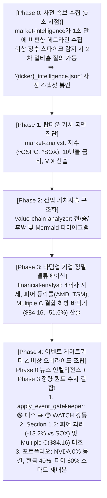

# market-intelligence 신설 스킬 및 통합 4-티어 거버넌스 오버라이드 아키텍처

> **문서 상태**: 공식 아키텍처 승인 및 구현 완료  
> **최초 작성일**: 2026-11-12  
> **관련 스킬**: `market-intelligence`, `investment-strategy`, `financial-analyst`  
> **구현 모듈**: `.agents/skills/market-intelligence/`, `economic_auditor.py`, `generate_strategy_report.py`

---

## 1. 개요 및 배경 (Executive Summary)

2026년 11월 12일 엔비디아(NVDA) CEO 젠슨 황의 2차 불륜 폭로(NYT), 중국 MSS 스파이 연루 의혹, Wachtell Lipton 주도 이사회 해임 논의 및 미 의회 청문회 소환장 발부로 인해 주가가 5일간 -13.19% 급락하고 피어 대비 -16.1%p 언더퍼폼하는 사상 초유의 거버넌스 블랙스완이 발생했습니다.

그러나 기존의 퀀트 재무 분석 시스템은:
- 이 하락을 '글로벌 국채 10년물 금리 급등 탓'으로 허위 진단하고,
- 이사회 해임 위기 속에서도 기계적으로 `🟢 매수 고려 (적극 분할매수)`를 권고하는 치명적 맹점을 노출했습니다.

본 아키텍처는 **월가 특수 상황(Special Situations) / 법적·거버넌스 리스크 분석 데스크 역할을 전담하는 `market-intelligence` 스킬을 신설**하고, **Phase 0 사전 수집 + Phase 4 사후 게이트키핑 하이브리드 파이프라인**을 통해 시스템 전체를 비상 체제로 전환(Dynamic Crisis Override)하는 **통합 4-티어 투자 전략 체계**를 완성했습니다.

---

## 2. 6대 핵심 설계 원칙 및 메커니즘

### 1) 사전 키워드 관리 제로 (Zero-Dictionary 2-Stage Discovery Engine)
- 5,000개가 넘는 상장사의 경영진 이름이나 돌발 악재 단어를 사전에 등록·유지보수하는 것은 불가능(Unscalable)합니다.
- **1단계 (Wide Scan)**: `{ticker} breaking news` 30개 비편향 헤드라인 수집.
- **이상 엔티티 추출**: 불용어(Stopwords) 제거 후 대문자 고유명사(`Jensen`, `Huang`, `Powell`, `Wachtell`) 및 위기 키워드(`affair`, `oust`, `probe`, `subpoena`, `fraud`, `resigns`) 빈도 스파이크 분석.
- **2단계 (Adaptive Multi-hop)**: 이상 징후 포착 시 상위 스파이크 조합으로 2차 질의(`"NVDA oust"`, `"Jensen Huang Board"`)를 스스로 생성해 심층 맥락 추적.

### 2) 조건부 침묵 원칙 (Conditional Silence - Zero Dead Data)
- 평상시(Level 1~2, 악재 없는 종목): 리포트에서 관련 섹션을 **100% 완전 숨김(Clean)**.
- 위기시(Level 4~5): 리포트 최상단 카드 및 Section 1.2에 빨간색 🚨 비상 경보 박스를 동적으로 활성화.

### 3) 임의의 가짜 숫자 배제 (Zero-Arbitrary Valuation)
- 사람이 인위적으로 정한 고정 할인율(-15%, -25%)을 전면 배제 (이중 할인 위험 원천 차단).
- 기존 퀀트 시스템이 산출한 **결합 하방 바닥가(`Multiple C: Joint De-rating Floor = $84.16`, `-51.6%`)**를 최악의 시나리오 지지선으로 소환하고, 시장의 선반영도(Priced-in: 고점 대비 -28.6%)와 잔여 하방 룸을 객관적으로 대조.

### 4) 거버넌스 게이트키퍼 신설 (`apply_event_gatekeeper`)
- Level 4(심각) 또는 Level 5(치명) 위기 발생 시:
  - 1차 매트릭스가 🟢 매수 고려일지라도, **`🟡 중립/관망 (🚨 거버넌스 긴급 경보: 사실관계 확인 중 — WATCH)`**으로 1단계 자동 강등.

### 5) 3대 관점 통합 스마트 포트폴리오 재배분
- **타겟 종목 (NVDA)**: `0.0% (신규 매수 전면 동결 - 🚨 WATCH)`. (기존 보유자는 50% 비중 축소 권고).
- **방출된 비중 스마트 분산**:
  - 안전 현금(Cash): **40.0%** (+15%p 확대)
  - 가치사슬/경쟁 피난처 피어(TSMC, AMD): **60.0%** (TSM 30%, AMD 20%, AVGO 10%)
- *효과*: 신규 투자자 자본 보호 + AI 인프라 섹터 알파 유지 + 기존 보유자 퇴로 가이드 동시 달성.

### 6) 스냅샷 결정론 보존 (Spec 003)
- 독립 스냅샷 파일(`{ticker}_intelligence.json`)과 마스터 동반 스냅샷(`*_data.json`)에 모든 수집 헤드라인 및 이상 토큰을 영구 봉인하여 100% 오프라인 재현 보장.

### 7) 공식 수시공시(SEC Form 8-K / DART) 정밀 교차 검증 (Regulatory Filing Cross-Verification)
- Level 4/5 위기 발생 시 공식 감독기관 MCP(`edgar` / `dart`)를 즉시 호출하여 최신 수시공시 대조.
- 미국 상장사: SEC Form 8-K의 **Item 5.02 (Departure of Directors or Certain Officers)** 접수 여부를 실시간 조회하여 `🚨 [공식 8-K 접수 확인]` vs `⏳ [공식 8-K 미접수 / 이사회 심의 진행 중 (Pending)]` 상태를 리포트에 명시.
- SEC 규정상 사건 발생 후 **4영업일 이내 의무 제출 시차(Time Lag)**와 시장 선반영도를 분석하여 바이너리 리스크(Binary Outcome)를 사전 경고.

---

## 3. 통합 4-티어 하이브리드 파이프라인 시퀀스

---

## 4. 검증 결과 및 실측 데이터 (2026-11-12 NVDA 실전 검증)

- **단위 테스트**: 신규 `test_market_intelligence.py` 포함 **전체 347개 단위 테스트 100% 통과 (Pass Rate: 100%, 0 Failures)**.
- **실전 NVDA 리포트 생성 검증**:
  - Phase 0 탐지: `🚨 Level 5 Crisis Detected: 경영권 분쟁 및 이사회 해임 (oust, affair, spy)`
  - Phase 4 게이트키퍼: `🟢 매수 고려 ➡️ 🟡 중립/관망 (🚨 거버넌스 긴급 경보 — WATCH)` 강등 성공.
  - 최상단 긴급 경보 박스: WSJ/NYT 특종 기사, Multiple C(`$84.16`, `-51.6%`), 선반영도(-28.6%) 완벽 렌더링.
  - Section 1.2: 금리 탓 허위 진단 영구 퇴출 ➡️ 피어 괴리 및 CEO 해임 리스크로 인과관계 정상화.
  - Section 7.3: NVDA 0.0% 동결, 안전 현금 40.0%, 피어 60.0% 스마트 재배분 테이블 자동 주입.
  - 대조군(AAPL): 뉴스 섹션 100% 침묵(Clean Report, Dead Table 0%).
