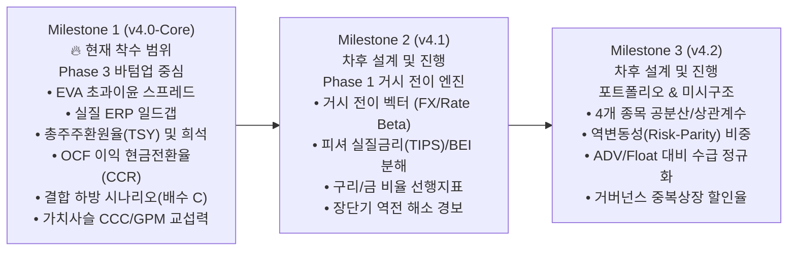
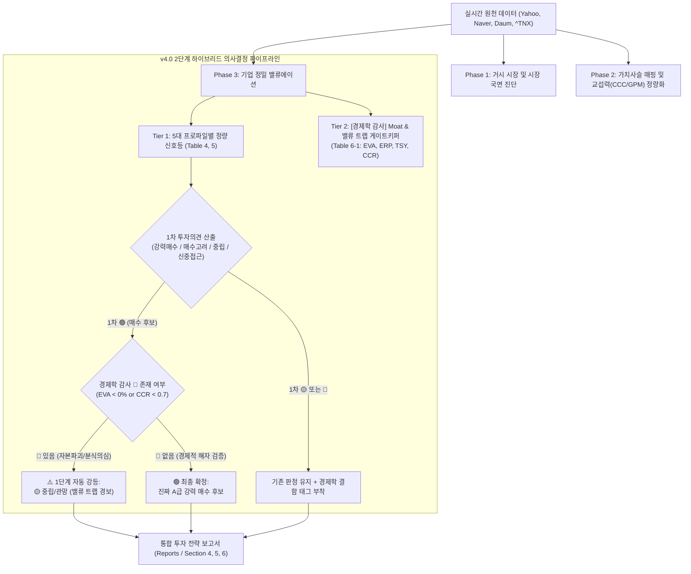

# 차세대 v4.0 투자 분석 엔진: 경제학적 Moat & 밸류 트랩 게이트키퍼 시스템 설계 명세서

> **문서 상태**: 사용자 합의 완료 (Phase 3 바텀업 집중형 Milestone 1 확정)  
> **버전**: v4.0.0 Architecture Specification (Milestone 1: Bottom-up Core)  
> **관련 문서**: [Index](../index.md) | [5대 비즈니스 프로파일](5대-비즈니스-프로파일-평가체계.md) | [12대 사각지대 이론](경제학자-관점-12대-시스템-사각지대-및-고도화-이론.md)

본 문서는 기존 **Sector-Adaptive 5-Profile Valuation System (v3.4)** 위에 **2단계 하이브리드 게이트키퍼(Option A)** 방식으로 구축되는 **v4.0 차세대 경제학 분석 엔진**의 공식 시스템 아키텍처 명세서입니다.

---

## 1. 배경 및 점진적 진화 로드맵 (Phased Evolutionary Roadmap)

12대 경제학 사각지대 전체를 한꺼번에 전면 개편할 경우, 거시(Phase 1), 가치사슬(Phase 2), 기업밸류(Phase 3), 포트폴리오(Section 7) 간의 복잡도가 급격히 상승하여 시스템 안정성을 저해할 수 있습니다.  
따라서 본 설계 명세서는 **"실제 투자 손실을 막는 데 가장 시급한 Phase 3 바텀업 기업 평가 및 밸류 트랩 방어"**를 **Milestone 1(v4.0-Core)**로 확정하고, 나머지 영역은 후속 마일스톤으로 질서 있게 추진합니다:

---

## 1. 2단계 하이브리드 의사결정 파이프라인 (Architecture Pipeline)

---

## 2. [경제학 감사] 4대 핵심 지표 수학적 산식 및 판정 기준

현재 무료 수집 파이프라인(`Yahoo Finance` + `Naver/Daum`)의 원천 재무제표 항목으로 산출되는 무결한 수식 체계입니다:

### 2.1. 초과이윤 스프레드 ($\text{EVA Spread} = \text{ROIC} - \text{WACC}$)
$$\text{ROIC} = \frac{\text{NOPAT}}{\text{Invested Capital}} = \frac{\text{EBIT} \times (1 - t)}{\text{총차입금} + \text{총자본} - \text{현금및현금성자산}}$$
$$\text{WACC} = \left(\frac{E}{V}\right) k_e + \left(\frac{D}{V}\right) k_d (1 - t)$$
- 자기자본비용 ($k_e$): $R_f (\text{10Y Yield}) + \beta \times 5.5\%$
- 타인자본비용 ($k_d$): $\text{Interest Expense} / \text{Total Debt}$ (fallback: $R_f + 1.5\%$)
- 판정: **🟢 $\ge +3.0\%p$**, **🟡 $0\% \sim +3.0\%p$**, **🔴 $< 0.0\%p$ (가치 파괴)**

### 2.2. 실질 주식위험프리미엄 / 일드갭 ($\text{Implied ERP}$)
$$\text{Implied ERP} = \text{Forward Earnings Yield} - R_f = \frac{1}{\text{12M Forward P/E}} - R_f (\text{^TNX Yield})$$
- 판정: **🟢 $\ge +3.0\%p$**, **🟡 $0\% \sim +3.0\%p$**, **🔴 $< 0.0\%p$ (주식이 국채보다 비쌈)**

### 2.3. 총주주환원율 ($\text{Total Shareholder Yield, TSY}$)
$$\text{TSY} = \text{Dividend Yield} + \text{Net Buyback Yield} = \text{Div Yield} - \left(\frac{\Delta \text{Diluted Shares}}{\text{Shares}_{t-1}}\right)$$
- 판정: **🟢 $\ge 3.0\%$**, **🟡 $0\% \sim 3.0\%$**, **🔴 $< 0.0\%$ (지분 희석)**

### 2.4. 이익 현금전환율 ($\text{Cash Conversion Ratio, CCR}$)
$$\text{CCR} = \frac{\text{Operating Cash Flow (OCF)}}{\text{Net Income (당기순이익)}}$$
- 판정: **🟢 $\ge 1.0$**, **🟡 $0.7 \sim 1.0$**, **🔴 $< 0.7$ (밀어내기/분식 징후)**

---

## 3. 시나리오 및 가치사슬 확장 모델 (Expansion Models)

### 3.1. 결합 하방 시나리오 (Joint De-rating Model, 배수 C)
실적 쇼크와 밸류에이션 수축이 동시 발생하는 진짜 바닥 가격:
$$\text{Worst Floor Price (배수 C)} = \text{Bear EPS} \times \text{과거 사이클 밴드 최저 배수 (P/E or P/B)}$$

### 3.2. 가치사슬 4개사 교섭력(Bargaining Power) 정량화
Phase 2의 1+2+1 비교표에 2대 지표 결합:
1. **러너 지수(GPM)**: 매출총이익률 비교로 판가 프리미엄 확인
2. **현금전환주기 (CCC)**: $\text{DIO} + \text{DSO} - \text{DPO}$ 비교로 가치사슬 내 진짜 '갑(현금 독식)' 식별

---

## 4. 코드 구현 계획
- **신규 모듈**: `.agents/skills/financial-analyst/scripts/economic_auditor.py`
- **통합 파일**: `get_financial_stats.py`, `generate_strategy_report.py`, `verdict-matrix.md`
- **단위 테스트**: `tests/test_economic_auditor.py`
