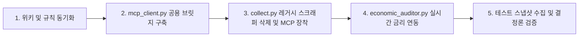

# 공식 MCP 전면 전환 및 레거시 데이터 수집 퇴출 아키텍처 로드맵

> **수립 일자**: 2026-11-12  
> **관련 문서**: [SCHEMA.md](../SCHEMA.md), [차세대 v4.0 투자시스템 설계명세서](경제학-인과관계-기반-차세대-v4-투자시스템-설계명세서.md), [데이터 품질 규칙](../../.agents/skills/financial-analyst/references/rules/data-quality.md), [스냅샷 규칙](../../.agents/skills/financial-analyst/references/rules/data-snapshot.md)  
> **핵심 원칙**: 헌법 원칙 II (출처 추적성), III (조용한 오류 금지), IV (단일 원본 체계), VI (Clean-Slate)

---

## 1. 추진 배경 및 문제 진단

기존 `financial-analyst` 및 `market-analyst` 파이프라인은 신뢰할 수 있는 공식 API의 부재로 인해 비인가 웹 크롤러, 라이브러리 스크래퍼, 거시 대용치(Proxy)에 과도하게 의존해 왔습니다. 이로 인해 다음과 같은 구조적 결함이 발생했습니다:

1. **비인가 스크래퍼의 상시 고장 및 차단 리스크**:
   - `pykrx`: 거래소 보안 정책 강화로 `KRX_ID`와 `KRX_PW`를 요구하며 캡차 차단 위험으로 인해 파이프라인에서 상시 `skipped` 상태로 방치됨.
   - `daum_quote`, `daum_investor_days`: 네이버 결측 대응용 임시 스크래퍼였으나, 헤더 위장 및 DOM 변경에 취약.
   - `nasdaq.com` historical scraper: 미국 나스닥 비인가 API 엔드포인트 크롤링으로 인한 간헐적 HTTP 403 차단.
2. **거시 지표의 대용치 왜곡 및 하드코딩 오차**:
   - `HYG / LQD` 비율: 신용 스프레드 대용치로 사용되었으나 듀레이션 불일치와 ETF 운용보수 왜곡 발생.
   - `^IRX`: 13주 단기국채 수익률이 은행 할인율 기준으로 산출되어 실제 만기수익률(YTM) 대비 약 **20bp 오차** 상시 내포.
   - `rf_rate = 4.5%` 하드코딩: 한국 상장기업의 자본비용(WACC) 및 경제적 부가가치(EVA) 평가 시 한국 국고채 10년물 대신 임의 고정값이나 미국 금리(`^TNX`)를 일괄 적용하는 치명적 왜곡.
3. **6대 금융 공식 MCP 허브(`finance-api-hub`) 확보**:
   - 한국거래소(`krx`), 금융감독원(`dart`), 토스증권(`toss`), 한국은행(`ecos`), 미 연준(`fred`), 미국 증권거래위원회(`edgar`)의 공식 API 키 및 표준 프로토콜 연동 완료.

---

## 2. 15회차 연속 실측 기반 타임라인 팩트 (DATA_TIMING)

야간 18:00부터 익일 08:37까지 15회에 걸친 정밀 실측을 통해 규명된 공식 MCP의 데이터 확정 타이밍을 본 아키텍처의 절대 불변 기준으로 삼습니다:

```
[15:30 정규장 마감]
  │  • 메리츠 일봉 종가(`market_candles_days`): KRX 정규장 공식 종가 확정
  │  • 토스 시장/종목 수급: NXT 애프터마켓(20:00 종료) 체결분이 반영되어 계속 변동
  │
[18:09 저녁 확정]
  │  • 한국은행 ECOS 시장금리(817Y002): 국고채 2~30년물, 회사채 AA- 당일 최종 고시 완료
  │  • DART 기업 공시: 장 마감 후 제출 공시 즉시 조회 가능
  │
[20:06:03 야간 수급 최종 확정]
  │  • 토스 시장 수급(`toss_market_investor_trading`): 20:06:03에 마지막 갱신되며 최종 확정 (초 단위까지 실측 검증)
  │  • 메리츠 상승/하락 종목 수: 당일 확정 완료
  │  • KRX Open API: 심야(20시~자정) 및 새벽 내내 전일치만 반환 (야간 갱신 일체 없음)
  │
[00:00 ~ 06:00 심야/새벽]
  │  • 미국 SEC EDGAR: 공시 1초 이내, XBRL 재무제표 1분 이내 실시간 파싱
  │  • 미국 FRED: 미국채 금리는 미국 시간 익일 오후 반영
  │  • 국내 API: 자정 배치 전무 (KRX는 그저께치 반환 지속)
  │
[06:10:04 아침 수급 최종 확정]
  │  • 토스 종목별 수급(`toss_stock_investor_trading`): 전 종목 외인/기관 7대 주체 순매수 06:10:04 최종 확정
  │
[08:00 ~ 08:30 아침 배치 완료]
  ▼
  • 한국거래소 KRX Open API(`krx_stock`): 전일 정규장 데이터(일봉, 등락, 시총, 상장주식수) 일괄 갱신 완료
  • 토스 시장 수급: 당일 프리마켓 집계로 리셋 (`date: 오늘` 생성)
```

---

## 3. 기존 수집 방식 퇴출(Deprecation) 및 이관 매트릭스

합의된 결정을 바탕으로 파이프라인에서 즉시 퇴출할 항목과 공식 MCP로 이관할 대상을 명확히 정의합니다:

| 기존 수집 함수 / 지표 | 기존 출처 | 변경 후 처리 방침 | 대체 공식 MCP 및 1순위 소스 | 퇴출/이관 사유 |
|---|---|---|---|---|
| `pykrx_fundamental` | PyKrx 라이브러리 | **완전 삭제 (퇴출)** | **KRX MCP** (`krx_stock`, fundamental) | KRX ID/PW 요구, IP 차단 리스크, 상시 결측 |
| `daum_quote`, `daum_investor_days` | 다음 금융 스크래핑 | **완전 삭제 (퇴출)** | **Toss MCP** (`toss_stock_investor_trading`) | 비인가 스크래핑 불안정. 토스가 7대 기관 세분화 및 06:10 확정 수급 제공 |
| `fetch_nasdaq_history` | 나스닥 비인가 API | **완전 삭제 (퇴출)** | **Yahoo Finance** (`history`) / **SEC EDGAR** | 비인가 크롤러 HTTP 403 오류 차단 |
| `HYG / LQD` 상대강도 | Yahoo ETF | **완전 삭제 (퇴출)** | **FRED MCP** (`BAMLH0A0HYM2`, `BAMLC0A4CBBB`) | ETF 듀레이션 및 보수 왜곡 배제, 실제 ICE BofA OAS 확정 스프레드 적용 |
| `^IRX` 단기국채 | Yahoo Finance | **완전 삭제 (퇴출)** | **FRED MCP** (`DGS3MO`) | 13주물 은행 할인율 20bp 오차 제거, 만기수익률(YTM) 일원화 |
| `rf_rate = 4.5%` 하드코딩 | 스크립트 기본값 | **완전 삭제 (퇴출)** | **ECOS MCP** (`ktb10y`) / **FRED MCP** (`DGS10`) | 국가별(한국: 국고채 10년, 미국: 10Y 국채) 실시간 무위험금리 자동 주입 |
| `naver_integration` (재무·시총·주가) | 네이버 모바일 API | **역할 축소** | **DART MCP** (재무/주식수) + **KRX MCP** (시총/종가) | 공식 공시 및 거래소 데이터 1순위 승격 |
| `naver_integration` (목표주가) | 네이버 모바일 API | **선행 전용 유지** | **네이버 금융** (국내 증권사 목표가 평균) | 공식 MCP에 애널리스트 목표가 부재하므로 유지 |
| `wisereport_eps` | WiseReport 웹 크롤링 | **선행 전용 유지** | **WiseReport** (30일 EPS 리비전, FY0·FY1 컨센서스) | 국내 유일의 30일 EPS 상향/하향 리비전 소스로 역할 한정 |
| `yahoo` (미국 재무제표) | Yahoo Finance | **Fallback 강등** | **SEC EDGAR MCP** (`sec_financials`, `sec_concept`) | 10년+ 감사 재무제표 원문, 파생 Q4, 실시간 주식수 SEC 1순위 승격 |

---

## 4. Spec 003 스냅샷 결정론(Determinism) 준수 원칙

기존 아키텍처의 핵심 헌법인 **Spec 003 파이프라인 분리 원칙**을 엄격히 준수합니다:

1. **네트워크 격리 (Isolation)**:
   - 외부 네트워크 통신 및 MCP 호출은 오직 수집기(`collect.py`, `market_collect.py`) 내부에서만 실행됩니다.
   - 하위 분석기(`get_financial_stats.py`, `economic_auditor.py`, `rebuild_section4.py`)는 디스크에 저장된 `inputs` 딕셔너리만 읽는 **순수 오프라인 결정론적(Pure Offline Deterministic) 함수**로 유지됩니다.
2. **2단계 안전 전환 (Backward Compatibility)**:
   - **Phase 1 (수집기)**: `collect.py`의 신규 수집 함수에서 퇴출 대상 스크래퍼 코드를 완전 삭제하고, 공식 MCP 클라이언트 호출을 장착합니다.
   - **Phase 2 (분석기)**: `get_financial_stats.py`는 신규 MCP 키(`krx_stock`, `dart_financials`, `toss_investor` 등)를 최우선 파싱하되, 기존에 생성된 과거 스냅샷(`_data.json`)의 `rebuild_section4.py` 재현이 깨지지 않도록 레거시 키 판독부를 Fallback 안전장치로 보존합니다.

---

## 5. 단계별 실행 일정 (Action Items)



1. **Step 1**: 위키 및 프로젝트 규칙 문서(`data-quality.md`, `data-snapshot.md`)에 확정안 동기화 완료.
2. **Step 2**: 파이썬 환경에서 Node.js 기반 6대 MCP를 표준 stdio JSON-RPC로 비동기/동기 호출하는 고속 경량 브릿지 `scripts/mcp_client.py` 구현.
3. **Step 3**: `collect.py` 리팩토링 — `pykrx`, `daum_quote`, `daum_investor_days`, `fetch_nasdaq_history` 완전 삭제, KRX/DART/TOSS/ECOS/FRED/EDGAR 수집 로직 배치.
4. **Step 4**: `economic_auditor.py` 리팩토링 — 하드코딩 `rf_rate`를 ECOS KTB 10년물 및 FRED DGS10으로 동적 대체.
5. **Step 5**: 삼성전자(`005930.KS`) 및 엔비디아(`NVDA`) 대상 테스트 스냅샷 수집 및 `rebuild_section4.py` 무결성 검증.
