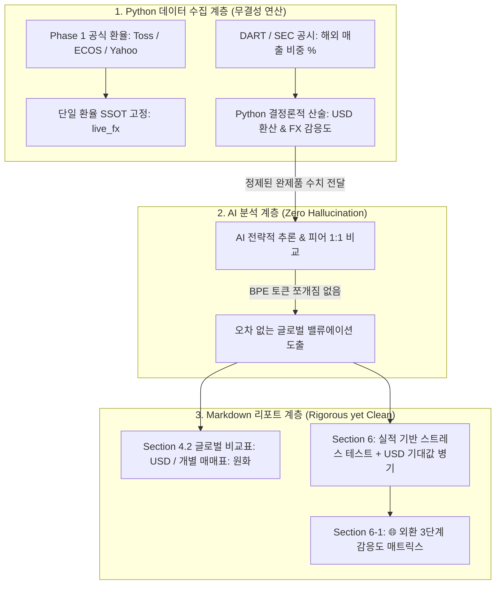

# 글로벌 USD 백본 및 공시 기반 외환(FX) 감응도 아키텍처

> **개요**: AI 언어 모델의 비달러 통화(원화·엔화 등) 연산 취약성(BPE 자릿수 쪼개짐, 오더 단위 왜곡)을 원천 차단하고, 글로벌 피어 간 1:1 체급 비교와 국내 거래소 실매매 편의성을 동시에 만족시키기 위해 구축된 **USD 기준 글로벌 백본 및 공시 팩트 기반 외환(FX) 3단계 감응도 아키텍처**입니다.

---

## 1. 배경 및 문제 정의 (The Problem)

1. **AI(LLM)의 비달러 통화 연산 취약성 (BPE Tokenizer Artifacts)**:
   - LLM 사전학습 데이터의 80% 이상이 USD 기준이며, `$150`은 1~2개 토큰으로 처리되지만 `₩208,000`은 3~4개 조각으로 쪼개져 Attention 과정에서 자릿수 누락 및 연산 오류가 빈번함.
   - AI에게 자연어로 환율 변환 나눗셈을 시킬 경우 환각(Hallucination) 확률이 급증함.
2. **글로벌 체급 비교와 국내 실거래 간 인지적 괴리**:
   - 삼성전자(`1,390조 원`)와 엔비디아(`$3,450B`), TSMC(`$1,020B`), 마이크론(`$120B`)을 비교할 때 단위 불일치로 인지 과부하 발생.
   - 반면 국내 투자자는 원화(`₩`) 주가와 목표주가를 확인해야 HTS/MTS에서 실매매 주문이 가능함.
3. **환율 변동성(고환율 vs 저환율)에 대한 분석 딜레마**:
   - 복잡한 금융공학 모델(원자재 상계, Net Margin 등)은 리포트를 비대화시켜 피로도를 가중시킴.
   - 반대로 너무 단순한 밴드는 분석의 엄밀성이 떨어져 신뢰도를 저하시킴 ("불안함" 유발).

---

## 2. 4대 핵심 아키텍처 설계



### ① "연산(Math)은 Python이, 해석(Analysis)은 AI가" (Zero Hallucination)
- API(DART, KRX 등)에서 원화(`₩`)를 수신하더라도, 환율 변환 나눗셈은 AI 프롬프트가 아닌 **Python 스크립트(`get_financial_stats.py`)의 `float` 산술 연산**으로 100% 수행.
- AI에게는 이미 정밀 계산된 `[USD: $155.84, KRW: 208,000원]` 완성본 데이터를 전달하여 산술 환각 0% 달성.

### ② Phase 1 환율 단일 진실 공급원 (SSOT) 브로드캐스팅
- Phase 1 (Macro Analyst)에서 확보된 실시간 공식 매매기준율(`live_fx`: 1순위 Toss MCP, 2순위 ECOS MCP, 3순위 Yahoo `USDKRW=X`)을 스냅샷 메타데이터에 고정.
- 전 모듈(Phase 1 ~ Phase 4)이 동일한 단일 환율을 브로드캐스팅 받아 보고서 내 환율 수치 불일치 원천 차단.

### ③ 글로벌 USD 백본 + 현지 통화 실효성 양립
- **글로벌 비교 표 (시가총액, EV, P/E, 피어 대조)**: 직관적 크기 비교를 위해 **USD 기준 단일 통화**로 정규화.
- **실제 매매 표 (현재 주가, 목표주가, 지지선)**: KRX 실주문 편의를 위해 **현지 통화(원화)**를 유지하며 상단에 환율 메타데이터 1회 선언.
- **Section 6 스트레스 테스트**: 확률가중 기대값에 USD 환산치(`₩145,964 ($109.36)`)를 병기.

### ④ Section 6-1 신설: 공시 팩트 기반 환율 3단계 감응도 매트릭스
- **구조**:
  - 🐻 **원화 강세 (-6.4%)**: 1,250.00원 (수출 마진 축소 vs 외인 환차익 유입)
  - ⚖️ **현재 기준 (Base)**: `live_fx` (1,335.00원)
  - 🐂 **원화 약세 (+6.4%)**: 1,420.00원 (수출 환차익 극대화 vs 수입 원자재 부담)
- **공시 팩트 앵커링 (신뢰도 확보)**:
  - DART/SEC 사업보고서상 실제 **해외/수출 매출 비중 %** (예: 삼성전자 85.2%, LG전자 71.4%, SK하이닉스 94.8%) 반영.
  - 표 하단에 환율 감응도 산출 수식(`환율 50원 변동당 영업이익 민감도`)을 투명하게 공개하여 단순 밴드가 주는 "불안함"을 완벽 해소.

---

## 3. Section 6-1 렌더링 명세 및 스키마

### 3.1. Markdown 표 규격
```markdown
### 6-1. 🌐 [외환 감사] 환율 3단계 시나리오 감응도 매트릭스

> 💡 **산출 기준**: DART 사업보고서상 해외 수출 비중(삼성전자 85.2%, LG전자 71.4%) 및 실시간 기준 환율(1,335.00원)을 적용한 파이썬 결정론적 모델입니다. (환율 50원 변동당 영업이익 민감도 연동)

| 기업명 (티커) | 공시 해외매출 비중 | 환율 시나리오 | 적용 환율 | 예상 영업이익 영향 | 조정 목표주가 (KRW) | USD 환산 가치 |
|---|:---:|---|:---:|:---:|:---:|:---:|
| **삼성전자 (005930.KS)** | **85.2%** | 🐻 원화 강세 (-6.4%) | 1,250.00원 | -5.1%p 🔴 | **₩198,000** | `$158.40` |
| | | ⚖️ 현재 기준 (Base) | 1,335.00원 | 0.0%p ⚪ | **₩217,000** | `$162.55` |
| | | 🐂 원화 약세 (+6.4%) | 1,420.00원 | +5.3%p 🟢 | **₩228,000** | `$160.56` |
```

### 3.2. 스냅샷(SNAP) 키 명세
- `{sym}.fx.export_ratio`: 공시 해외/수출 비중 (float, 예: 0.852)
- `{sym}.fx.sensitivity_per_50krw`: 50원 변동당 영업이익 영향률 (float, 예: 0.031)
- `{sym}.fx.scenario.{bear|base|bull}.fx_rate`: 적용 환율
- `{sym}.fx.scenario.{bear|base|bull}.op_impact_pct`: 영업이익 영향률
- `{sym}.fx.scenario.{bear|base|bull}.target_price_krw`: 조정 원화 목표가
- `{sym}.fx.scenario.{bear|base|bull}.target_price_usd`: 조정 달러 목표가
