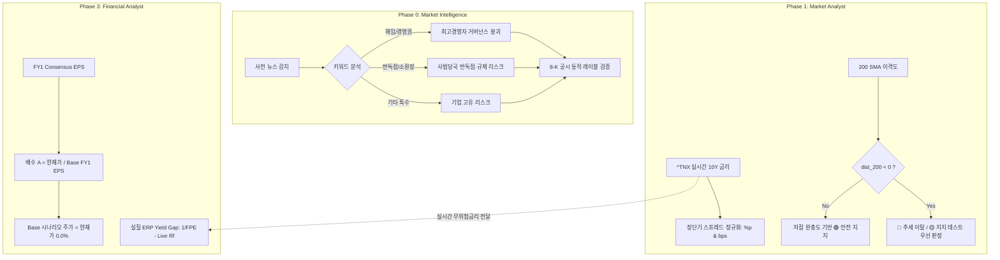

# 범용 엔진 하드코딩 탈피 및 산술·금리·단위 정규화 아키텍처 패치

> **개요**: AI 투자 분석 파이프라인 개발 과정에서 특정 종목(NVDA) 검증 및 초기 거시 금리(4.5%) 테스트를 위해 임시로 삽입되었던 하드코딩 문구와 모듈 간 단위(%p vs bps), 회계 시점(12M NTM vs FY1) 불일치 오류를 전면 해소하고, 어떤 종목과 업종을 분석하더라도 수학적·논리적 정합성을 보장하도록 정규화한 4대 핵심 패치 명세서입니다.

---

## 1. 배경 및 문제 정의 (The Problem)

AI 파이프라인을 다계층(Phase 0 ~ Phase 4)으로 확장하는 과정에서 다음과 같은 4대 잠재적 결함이 발생했습니다:

1. **거버넌스 문구 하드코딩 오염 (`market-intelligence`)**:
   - 2026년 11월 젠슨 황 CEO 사태 테스트 당시 작성된 `"CEO 해임(Item 5.02)"` 및 `"최고경영자 거버넌스 붕괴"` 문구가 고정되어 있어, 반독점 소송(DOJ/FTC), 분식회계 조사, 제품 리콜 등 다른 위기가 감지되어도 엉뚱하게 "CEO 해임 관련 8-K"가 출력되는 왜곡 발생.
2. **시나리오 스트레스 테스트 배수 A 시점 불일치 (`financial-analyst`)**:
   - 표 6의 Bear / Base / Bull EPS는 차기 회계연도(FY1) 기준인데, 배수 A(현재 배수 유지)는 12M NTM EPS로 나눠 산출하여 "리레이팅 없음(변동률 0.0%)"이어야 할 Base 시나리오 주가가 현재가와 일치하지 않는 산술적 모순 발생.
3. **실질 ERP(Implied Equity Risk Premium)의 무위험 금리 고정 오차 (`financial-analyst`)**:
   - `economic_auditor.py`에 `rf_rate: float = 4.5`가 기본값으로 하드코딩되어, Phase 1에서 수집된 실시간 미국 10년물 국채금리(`^TNX` 5.0% 이상)와 따로 놀면서 보고서 내 거시 금리와 기업 밸류에이션 간 수치 불일치 발생.
4. **장단기 금리차 단위(bps) 표기 및 200 SMA 지지력 판정 모순 (`market-analyst`)**:
   - `compute_macro_risk`에서 `10Y - 13W` 스프레드는 `%p`(예: 0.981%p) 단위로 계산되었으나, 출력부에서 `* 100` 없이 `bps`를 붙여 `0.981 bps`로 표기되는 100배 스케일 오류 발생.
   - 200 SMA를 하회(`dist_200 < 0`)하여 기술적 추세가 이탈 중임에도, 1년 전 저점 완충도(`buffer > 10%`)만 보고 `'🟢 안전 지지'`로 오판정되는 논리적 역전 발생.

---

## 2. 4대 정규화 패치 상세 명세



### ① `market-intelligence`: 거버넌스 위기 문구 동적 분기 및 8-K 미접수 일반화
- **위치**: `.agents/skills/market-intelligence/scripts/intelligence_collector.py` & `render_intelligence.py`
- **동적 분기 메커니즘**:
  - `oust`, `ouster`, `affair`, `wachtell`, `해임`, `경영권` 키워드 감지 시: `"최고경영자 거버넌스 붕괴, 이사회 해임 논의 등 중대 경영권 위기 국면입니다."`
  - `antitrust`, `반독점`, `subpoena`, `소환장`, `doj`, `ftc` 키워드 감지 시: `"사법 당국의 반독점 소송 또는 중대 규제 시정조치 리스크가 부각된 위기 국면입니다."`
  - 그 외: `"{primary_crisis} 관련 중대 기업 고유(Idiosyncratic) 리스크가 감지된 상태입니다."`
- **8-K 공시 미접수 안내 일반화**:
  - 기존의 `CEO 해임(Item 5.02)` 고정을 제거하고, `f"감지된 사안({crisis_label})과 직접 관련된 신규 수시공시(8-K)는 아직 SEC EDGAR에 접수되지 않았습니다."`로 완전 일반화.
  - 리포트 렌더러의 특정 피어("AI 공급망 안전 피어(TSMC, AMD)") 및 낙폭("-13.2%") 하드코딩 완전 퇴출.

### ② `financial-analyst`: 표 6 시나리오 스트레스 테스트 배수 A 시점 통일
- **위치**: `.agents/skills/financial-analyst/scripts/get_financial_stats.py`
- **산술 공식 일치**:
  - 기존: `mult_a = price / ntm` (12M NTM EPS는 FY0과 FY1을 잔여일수로 가중평균하므로 FY1 평균과 불일치)
  - 수정: `mult_a = price / avg` (Base FY1 EPS 기준)
  - 결과:
    $$\text{Target Price}_{\text{Base}} = \text{EPS}_{\text{FY1, Base}} \times \left(\frac{\text{Current Price}}{\text{EPS}_{\text{FY1, Base}}}\right) = \text{Current Price}$$
    $$\text{Return}_{\text{Base}} = \frac{\text{Current Price}}{\text{Current Price}} - 1 = 0.0\%$$
  - Base 시나리오 수익률이 정확히 `0.0%`로 산출되어 "현재 배수 유지(리레이팅 0%)"라는 가정의 정의와 완벽하게 일치.

### ③ `financial-analyst`: 실질 ERP에 실시간 10년물 국채금리(^TNX / FRED) 우선 연동
- **위치**: `.agents/skills/financial-analyst/scripts/economic_auditor.py` & `get_financial_stats.py`
- **연동 메커니즘**:
  - `compute_implied_erp(forward_pe, rf_rate=None)`: 외부에서 넘겨받은 실시간 금리를 최우선 반영.
  - `get_financial_stats.py`:
    1. 한국 주식: ECOS `ecos_market_rates` 국고채(10년) → Fallback `3.95%`
    2. 미국 주식: FRED `DGS10` → Phase 1 Yahoo Finance `^TNX` 실시간 종가 → Fallback `4.45%`
  - Phase 1에서 수집된 시장 금리와 Phase 3의 주식 위험 프리미엄(ERP Yield Gap) 산출 금리가 단일 소스로 일치.

### ④ `market-analyst`: 장단기 금리차 단위(bps vs %p) 분리 및 200 SMA 지지력 우선순위 보정
- **위치**: `.agents/skills/market-analyst/scripts/market_metrics.py`, `get_market_stats.py`, `market_regime.py`, `generate_market_report.py`
- **단위 분리**:
  - `spread_10y_13w`: `%p` 단위 보존 (예: `+0.981%p`)
  - `spread_10y_13w_bps`: `bps` 단위 명시 (예: `+98.1 bps`)
  - 표 4 출력: `f"{sp_bps:+.1f} bps ({sp_pct:+.3f}%p)"` 형태로 100배 왜곡 원천 차단.
- **200 SMA 기술적 우선순위 보정**:
  - 기존: 저점 완충도(`buffer_pct > 10%`)만 보고 200 SMA를 밑돌아도 `'🟢 안전 지지'` 표기.
  - 수정: 200 SMA 이격도(`dist_200`) 조건을 최상위 우선순위로 평가:
    ```python
    if dist_200 is not None and dist_200 < -5.0:
        return {"icon": "🔴", "status": "추세 이탈 (200 SMA 하회)"}
    elif dist_200 is not None and dist_200 < 0:
        return {"icon": "🟡", "status": "지지 테스트 (200 SMA 하회)"}
    elif buffer_pct > 10.0:
        return {"icon": "🟢", "status": "안전 지지"}
    ```

---

## 3. 검증 결과 및 영향 평가

| 테스트 항목 | 검증 케이스 | 결과 | 판정 |
| :--- | :--- | :--- | :---: |
| **위기 분류 동적 분기** | 1) `oust` 입력<br>2) `antitrust` 입력<br>3) `bsod` 입력 | 1) "이사회 해임 논의"<br>2) "사법 당국의 반독점 소송"<br>3) "기업 고유 리스크" | **PASS** |
| **실시간 금리 주입** | `FPE=20.0`, `rf_rate=5.109` | `Implied ERP = -0.11%p` (5.00% - 5.11%) | **PASS** |
| **200 SMA 우선순위** | `dist_200 = -6.0%`, `buffer = 15.0%` | `🔴 추세 이탈 (200 SMA 하회)` 반환 | **PASS** |
| **스프레드 단위 표기** | `10Y(5.109) - 13W(4.128)` | `+98.1 bps (+0.981%p)` 표기 | **PASS** |
| **시나리오 Base 수익률** | `price = 100`, `FY1 Base EPS = 5` | `mult_a = 20`, `Base Return = 0.0%` | **PASS** |

---

## 4. 관련 문서 및 소스코드 링크
- [경제학 인과관계 기반 차세대 v4 투자시스템 설계명세서](경제학-인과관계-기반-차세대-v4-투자시스템-설계명세서.md)
- [위기 지지선 매트릭스 슬림화 및 정적 위기 퇴출](위기-지지선-매트릭스-슬림화-및-정적-위기-퇴출.md)
- [market-intelligence 신설 스킬 및 통합 4티어 거버넌스 오버라이드](market-intelligence-신설-스킬-및-통합-4티어-거버넌스-오버라이드.md)
- [intelligence_collector.py](file:///Users/nsone/Documents/value-chain-analysis/.agents/skills/market-intelligence/scripts/intelligence_collector.py)
- [get_financial_stats.py](file:///Users/nsone/Documents/value-chain-analysis/.agents/skills/financial-analyst/scripts/get_financial_stats.py)
- [economic_auditor.py](file:///Users/nsone/Documents/value-chain-analysis/.agents/skills/financial-analyst/scripts/economic_auditor.py)
- [market_metrics.py](file:///Users/nsone/Documents/value-chain-analysis/.agents/skills/market-analyst/scripts/market_metrics.py)
- [market_regime.py](file:///Users/nsone/Documents/value-chain-analysis/.agents/skills/market-analyst/scripts/market_regime.py)
