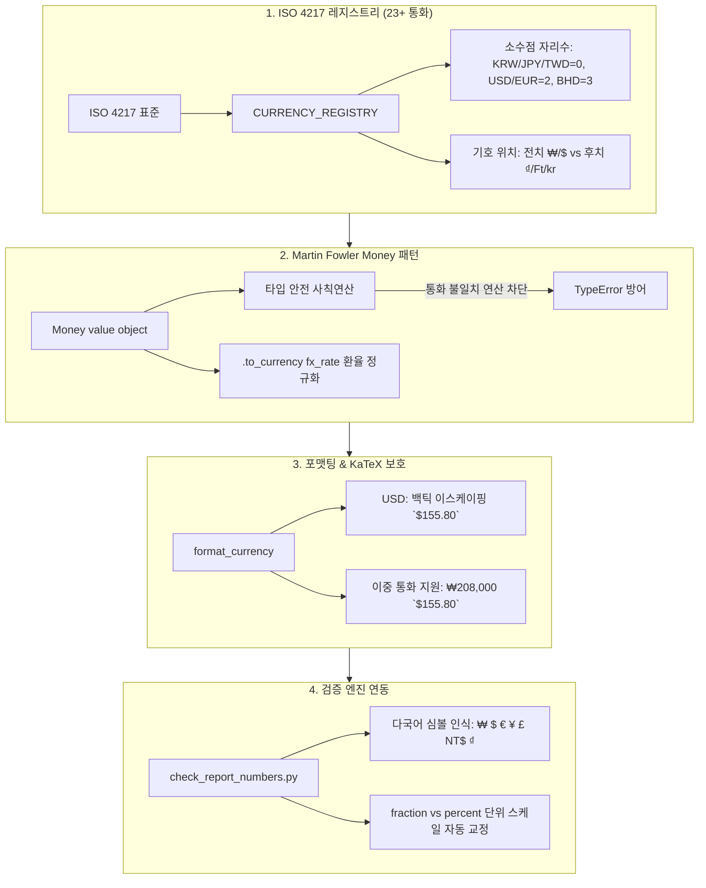

# 전세계 통화 관리 및 ISO 4217 환율 정규화 아키텍처

> **개요**: 글로벌 금융 데이터 파이프라인에서 다국적 통화(USD, KRW, JPY, EUR, TWD, VND 등)를 표준화하여 취급하고, LLM의 토크나이저(BPE)에 의한 비달러 통화 산술 환각을 원천 차단하기 위한 **ISO 4217 기반 통화 관리 라이브러리(`currency_manager.py`)와 Martin Fowler Money 패턴 아키텍처**입니다.

---

## 1. 배경 및 문제 정의 (The Problem)

### 1.1. AI 모델의 비달러 통화 산술 취약성 (BPE Tokenizer Artifacts)
- **달러 편향 사전학습**: LLM(GPT, Claude, Gemini)의 사전학습 말뭉치(Corpus)의 80% 이상이 미국 달러(`$`) 기준입니다.
- **BPE 서브워드 분절 왜곡**:
  - `$155`는 1~2개 토큰으로 압축 인지되지만, `₩208,000`은 `₩`, `208`, `,`, `000` 등 3~4개의 서브워드로 쪼개집니다.
  - 이로 인해 프롬프트 내부에서 나눗셈(`208,000 / 1,335`)을 자연어로 지시할 경우 자릿수 누락, 오더 단위 왜곡(조/억/Million/Billion 착오), 계산 환각이 빈번하게 발생합니다.

### 1.2. 무분별한 외부 라이브러리(Babel/Num2words)의 의존성 리스크
- 시스템 표준 규약인 **Spec 003(오프라인 순수 결정론)**에 따라 파이프라인 연산 모듈은 외부 네트워크나 비인가 무거운 외부 패키지에 의존하지 않고, 순수 Python 표준 라이브러리(`dataclasses`, `math`, `typing`)만으로 독립 구동되어야 합니다.

### 1.3. 마크다운 KaTeX 인라인 수식 충돌 ($ Collision)
- 마크다운 보고서 본문이나 테이블 내에 `$155.80`과 `$162.55`가 연속으로 등장하면 KaTeX 렌더러가 두 달러 기호 사이의 텍스트를 인라인 LaTeX 수식(`$ ... $`)으로 오인하여 렌더링이 깨지는 현상이 발생합니다.

---

## 2. 4대 핵심 아키텍처 설계



---

## 3. 세부 구현 명세 (`currency_manager.py`)

### 3.1. ISO 4217 글로벌 통화 레지스트리 (`CURRENCY_REGISTRY`)
전 세계 23개 이상의 주요 통화에 대한 통화 코드, 공식 기호, 표준 소수점 자릿수(Decimals), 기호 전치 여부(`symbol_prefix`)를 불변 객체(`CurrencyInfo`)로 선언합니다.

| 통화 코드 | 공식 기호 | 소수점 자릿수 | 기호 위치 | 대표 국가/지역 |
|:---:|:---:|:---:|:---:|:---|
| **KRW** | `₩` | **0** | 전치 (`₩208,000`) | 대한민국 원 |
| **JPY** | `¥` | **0** | 전치 (`¥28,500`) | 일본 엔 |
| **TWD** | `NT$` | **0** | 전치 (`NT$1,050`) | 대만 달러 |
| **VND** | `₫` | **0** | 후치 (`500,000 ₫`) | 베트남 동 |
| **USD** | `$` | **2** | 전치 (``$155.80``) | 미국 달러 |
| **EUR** | `€` | **2** | 전치 (`€750.50`) | 유로존 |
| **GBP** | `£` | **2** | 전치 (`£120.30`) | 영국 파운드 |
| **CNY** | `¥` | **2** | 전치 (`¥1,250.00`) | 중국 위안 |
| **BHD** | `BD` | **3** | 전치 (`BD15.750`) | 바레인 디나르 |

### 3.2. Martin Fowler Money 패턴 (`Money`)
화폐 금액과 통화 코드를 단일 불변 객체로 캡슐화하여, 서로 다른 통화 간의 무분별한 덧셈·뺄셈 연산을 원천 차단합니다.

```python
@dataclass(frozen=True)
class Money:
    amount: float
    currency: str = "USD"

    def __post_init__(self):
        info = get_currency_info(self.currency)
        object.__setattr__(self, "currency", info.code)
        # 통화별 표준 소수점에 따른 자동 반올림 정규화
        rounded = round(float(self.amount), info.decimals) if info.decimals > 0 else round(float(self.amount))
        object.__setattr__(self, "amount", rounded)

    def __add__(self, other: "Money") -> "Money":
        if self.currency != other.currency:
            raise TypeError(f"Cannot add different currencies: {self.currency} and {other.currency}.")
        return Money(self.amount + other.amount, self.currency)

    def to_currency(self, target_currency: str, fx_rate: float) -> "Money":
        """결정론적 환율 변환 수행"""
        if target_currency.upper() == self.currency:
            return self
        return Money(self.amount * fx_rate, target_currency)
```

### 3.3. KaTeX 충돌 방지 및 이중 통화 포맷팅 (`format_currency`)
1. **USD 백틱 이스케이핑 (`code_wrap_usd=True`)**:
   - `$` 단독 노출 시 KaTeX 인라인 수식으로 인식되는 문제를 방지하기 위해 USD 통화는 기본적으로 백틱(`` `$155.80` ``)으로 감쌉니다.
2. **이중 통화 자동 병기 (`dual_fx_rate`)**:
   - 기준 환율이 주어졌을 때 원화 실매매와 글로벌 USD 비교를 한눈에 볼 수 있도록 `₩208,000 ($155.81)` 형식으로 자동 렌더링합니다.

---

## 4. 검증 엔진 및 리포트 파이프라인 통합

### 4.1. `get_financial_stats.py` 통합
- 모든 재무 배수, 시가총액, EPS, 목표주가 렌더링 함수(`format_number`)를 `currency_manager.format_currency()`로 위임.
- **Section 6-1 🌐 외환 3단계 감응도 매트릭스**의 각 시나리오(Bear, Base, Bull) 목표주가를 `format_currency`를 통해 KRW 및 USD로 정밀 산출.

### 4.2. `check_report_numbers.py` 정규식 다국어 심볼 확장
보고서 감사 엔진의 화폐 파싱 정규식을 글로벌 심볼로 확장하여 원화 외에 달러, 유로, 엔화, 파운드, 대만달러, 베트남동 수치를 완벽히 인식:
```python
# 기존: (?P<cur>[₩$])?
# 확장 후:
NUMBER_PATTERN = re.compile(
    r"(?P<prefix>[~≈+-]?)\s*"
    r"(?P<cur>[₩$€¥£]|NT\$|₫)?\s*"
    r"(?P<sign>[+-]?)\s*"
    r"(?P<digits>\d{1,3}(?:,\d{3})*|\d+)"
    r"(?P<dec>\.\d+)?"
    r"(?P<mag>[억조京]|%p|bps|bp|x|배|k|m|b|t)?"
    r"(?P<pct>%|\bpercent\b)?"
    r"(?P<suffix_cur>\s*(?:원|KRW|USD|달러|위안|엔|유로))?",
    re.IGNORECASE,
)
```

### 4.3. 단위 스케일(Fraction vs Percent) 충돌 해소
- `export_ratio`, `op_impact`, `shift` 등 민감도 지표의 경우, 스냅샷의 `0.064`를 보고서의 `+6.4%`로 매칭할 때 스케일 100배 차이를 정규화하도록 `PATH_KINDS['fraction']` 패턴에 등록.

---

## 5. 결론 및 기대 효과

1. **산술 환각(Hallucination) 제로화**: "연산은 Python이, 해석은 AI가" 원칙에 따라 복잡한 다통화 나눗셈을 Python 단일 진실 공급원(SSOT)에서 완결.
2. **글로벌 통화 호환성 극대화**: 미국(USD), 한국(KRW), 일본(JPY), 대만(TWD), 유럽(EUR) 등 글로벌 공급망 분석 시 각국 통화의 소수점 자릿수와 표기법 완벽 준수.
3. **Spec 003 오프라인 재현성 100% 보장**: 외부 의존성 없는 순수 표준 라이브러리 기반으로 언제 어디서든 동일한 테스트 결과 산출.

---

## 6. 상호 참조 (Interlinking)
- [글로벌 USD 백본 및 공시 기반 외환(FX) 감응도 아키텍처](글로벌-USD-백본-및-공시-기반-외환-감응도-아키텍처.md)
- [범용 엔진 하드코딩 탈피 및 산술·금리·단위 정규화 아키텍처 패치](범용-엔진-하드코딩-탈피-및-산술·금리·단위-정규화-패치.md)
- [5대 비즈니스 프로파일 평가 체계](5대-비즈니스-프로파일-평가체계.md)
- [공식 MCP 전면 전환 및 레거시 데이터 수집 퇴출 로드맵](공식-MCP-전환-및-레거시-수집-퇴출-로드맵.md)
