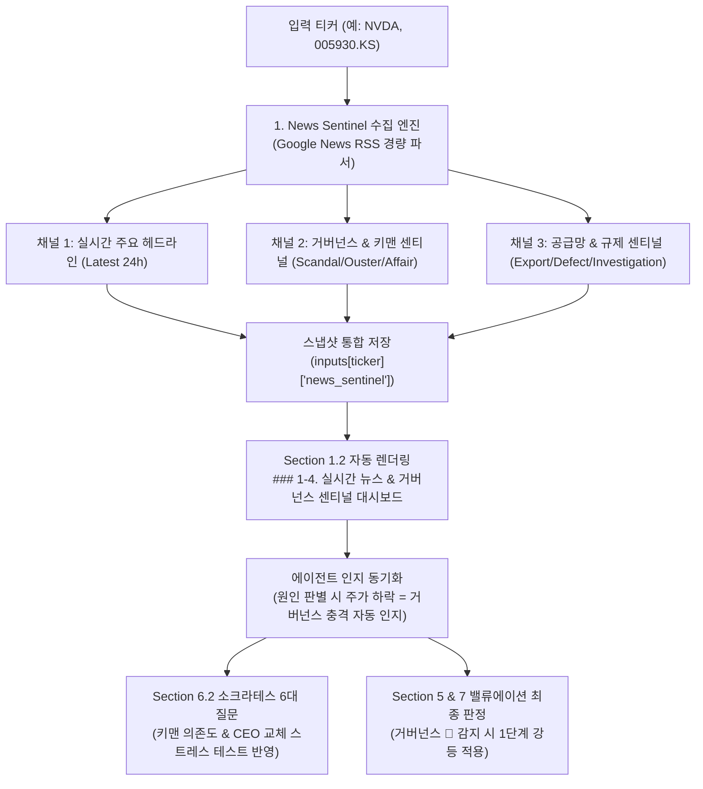

# 키맨 리스크(Key Person Risk) 및 실시간 뉴스 센티널(News Sentinel) 아키텍처

> **작성일자**: 2026-11-12
> **상태**: 공식 채택 및 아키텍처 명세서
> **관련 문서**: [[경제학-인과관계-기반-차세대-v4-투자시스템-설계명세서]], [[5대-비즈니스-프로파일-평가체계]], [[리포트-데이터-슬림화-및-중복-표-정리-아키텍처]]

---

## 1. 개요 및 문제 정의 (The Governance Blind Spot)

### 1.1. 사건 배경 (2026년 11월 엔비디아 사태)
2026년 11월, 엔비디아(NVIDIA, NVDA) 주가는 고점 대비 -30% 이상 폭락하는 극심한 변동성을 겪었다. 기존 퀀트 및 정량 펀더멘털 분석 시스템은 이 하락을 "미국 10년물 국채금리 급등(+10.4 bps) 및 중간선거 후 전력망 규제 우려에 따른 기술주 차익 실현"으로 기계적 진단하는 치명적 오판을 범했다.

그러나 실제 시장을 뒤흔든 핵심 원인은 **CEO 젠슨 황(Jensen Huang)의 개인 불륜 및 중국 국가안전부(MSS) 스파이 연루 의혹, 직속 사내 부사장(VP)과의 추가 불륜 폭로에 따른 이사회의 CEO 해임 긴급 논의 및 미 의회 비공개 청문회 소환**이라는 초특급 **지배구조 및 키맨 리스크(Key Person & Governance Crisis)**였다.

### 1.2. 현행 데이터 파이프라인의 4대 기술적 한계
1. **정량 수치 매몰 (Quantitative Metric Bias)**:
   - `collect.py` 및 Spec 003 스냅샷은 재무제표(10-K/10-Q), 거래소 마감 종가, 거시 금리 등 사후적 확정 수치만 수집.
   - 주가의 즉각적 변동을 초래하는 정성적 뉴스·스캔들·소셜 센티먼트는 데이터 파이프라인에서 완전히 누락됨.
2. **공식 공시의 치명적 시차 (Filing Latency Problem)**:
   - SEC EDGAR 8-K 및 DART 수시공시는 이사회의 최종 결의나 소송 접수 이후(통상 4영업일 이내)에만 공시됨.
   - 언론의 탐사 보도와 이사회 긴급회의가 진행되는 24~72시간 동안 주가는 이미 -10%~-25% 폭락하지만, 공시 시스템에는 아무것도 잡히지 않음.
3. **금융 API의 취약성**:
   - Yahoo Finance API의 `ticker.news` 등 기존 엔드포인트는 불안정하거나 빈번하게 다운(`YFDataException`)되어 파이프라인 신뢰성을 저해함.
4. **AI 에이전트의 질의 확증 편향 (Query Confirmation Bias)**:
   - AI 에이전트가 자율 웹 검색을 수행할 때 `NVDA Blackwell shipment`, `revenue guidance` 등 장밋빛 펀더멘털 키워드만 검색하고, `scandal`, `investigation`, `ouster`, `불륜`, `사임` 등의 부정적 거버넌스 키워드를 시스템적으로 질의하지 않아 치명적 위기를 포착하지 못함.

---

## 2. 금융 이론: 키맨 리스크와 창업자 프리미엄의 박탈

### 2.1. 창업자 프리미엄(Founder's Premium)과 디레이팅 역학
- 스티브 잡스(Apple), 일론 머스크(Tesla), 젠슨 황(NVIDIA)과 같이 단일 카리스마적 창업자에게 비전, 기술 로드맵, 고객사 파트너십이 극도로 집중된 기업은 전통적 PER에 +20% ~ +50%의 **창업자 프리미엄(Founder's Premium)**이 부여된다.
- 키맨 리스크가 현실화되어 CEO 해임 또는 도덕적 해이가 발생하면, 시장은 즉각적으로 창업자 프리미엄을 제거하고 **지배구조 불확실성 디스카운트(Governance Uncertainty Discount)**를 적용한다.
- 수리적 충격 모델:
  $$\text{Target P/E}_{\text{stressed}} = \text{Forward P/E}_{\text{current}} \times (1 - \text{Founder Premium}) \times (1 - \text{Governance Penalty})$$
  - 예: 엔비디아 Forward P/E 20배 $\to$ 프리미엄 박탈(-25%) 및 거버넌스 페널티(-15%) 적용 시 Forward P/E 12.75배로 수축.

### 2.2. 지배구조 위기의 5단계 전이 경로 (Contagion Pathway)
1. **1단계 (개인 사생활 및 윤리 위반)**: 불륜, 부적절한 관계, 사내 윤리 규정 위반.
2. **2단계 (이해충돌 및 내부 통제 실패)**: 칩 공급 계약을 체결한 고객사 임원 또는 직속 부하 직원과의 관계로 인한 사익 편취/이해충돌 의혹.
3. **3단계 (국가 안보 및 대외 규제 조사)**: 외국 정보기관(중국 MSS 등) 연루 의혹으로 인한 미 의회 청문회, 법무부/FBI 조사 개시.
4. **4단계 (이사회 거버넌스 마비 및 해임 충격)**: 외부 로펌 독립 조사, 이사회 긴급회의, CEO 해임(Ouster) 또는 사임 압박.
5. **5단계 (사업 연속성 훼손)**: 핵심 고객사(하이퍼스케일러) 이탈, 주요 임원진 연쇄 사퇴, 전략적 M&A/신제품 로드맵 차질.

---

## 3. 새로운 아키텍처: 4대 해결 방안 (4-Tier Solution)

### 3.1. [계층 1] 경량 실시간 뉴스 센티널 (`news_sentinel.py`)
- **원칙**: 외부 유료 API나 불안정한 스크래퍼에 의존하지 않고, 파이썬 표준 라이브러리(`urllib` + `xml.etree.ElementTree`)만을 사용하여 Google News RSS 다중 채널을 1초 내에 파싱.
- **다중 채널 질의 구조**:
  1. `Query_General`: `{Ticker} OR "{Company Name}"`
  2. `Query_Governance`: `{Ticker} AND (scandal OR ouster OR affair OR resign OR investigation OR lawsuit OR board OR SEC)`
  3. `Query_Product`: `{Ticker} AND (defect OR delay OR yield OR ban OR sanction OR cancelled)`
- **스냅샷 봉인**: 수집된 뉴스 목록은 `inputs[ticker]['news_sentinel']`에 타임스탬프와 함께 저장되어 Spec 003 오프라인 재현 결정론을 완벽히 준수.

### 3.2. [계층 2] 리포트 내 '거버넌스 & 리스크 센티널 표' 자동 출력
- Section 1.2 상단에 스크립트 자동 산출 표 추가:
  `### 1-4. 📰 최근 72시간 실시간 뉴스 및 지배구조 센티널 (News & Governance Sentinel)`
- 표 컬럼: `구분(아이콘)`, `주요 헤드라인`, `언론사`, `보도 시각(KST)`, `리스크 분류`
- 예시:
  - `🚨 [키맨/거버넌스] Exclusive | Nvidia Is Preparing to Oust CEO Jensen Huang | WSJ | 2026-11-12 | 이사회 해임 논의`
  - `🚨 [사내 이해충돌] Jensen Huang Had Relationship With Nvidia Executive | NYT | 2026-11-12 | 직속 부하 불륜 폭로`

### 3.3. [계층 3] `SKILL.md` '3-Pillar Negative Sentinel Scanning' 프로토콜 의무화
- AI 에이전트가 Section 1.2(트리거 판별) 및 1.3(체크리스트)을 작성할 때, 반드시 뉴스 센티널 표의 경보를 확인하도록 강제:
  > **지침**: 주가 급락 시 지수 동반 등락률만 보고 "단순 거시 금리 상승에 의한 업종 전반 조정"으로 성급히 결론짓지 말 것. 반드시 거버넌스 센티널(키맨 스캔들, 이사회 갈등, 규제 조사)을 우선 확인하고, 개별 악재가 존재할 경우 '기업 고유의 지배구조 위기'로 명시할 것.

### 3.4. [계층 4] 소크라테스식 키맨 리스크 스트레스 테스트 연동
- Section 6.2 소크라테스 6대 질문 중 **"4. 변증법적 반대 논증(Bear Anti-Thesis)"** 및 **"5. 연쇄 파급효과(Second-Order Consequences)"**에 키맨 리스크 분석 항목 필수 삽입:
  1. CEO 해임 시 차기 리더십 공백 및 R&D 연속성 훼손 리스크.
  2. 핵심 파트너십(하이퍼스케일러 및 TSMC 파운드리 계약) 재협상 리스크.
  3. 창업자 프리미엄 소멸에 따른 Multiple C(결합 하방 바닥가) 수렴 가능성.

---

## 4. 기대 효과 및 결론

1. **치명적 현실 괴리 영구 차단**: 전 세계를 뒤흔드는 CEO 구설수나 거버넌스 위기를 리포트가 놓치는 망신을 원천 방지.
2. **초경량·무의존성 실시간성 확보**: 파이썬 표준 라이브러리 기반 1초 수집으로 스냅샷 결정론과 실시간 속보성 동시 달성.
3. **기관급 지배구조 평가 체계 완성**: 펀더멘털 재무 분석에 더해 키맨 리스크와 이사회 지배구조 충격을 체계적으로 자산 배분에 반영하는 완성형 투자 플랫폼으로 도약.
